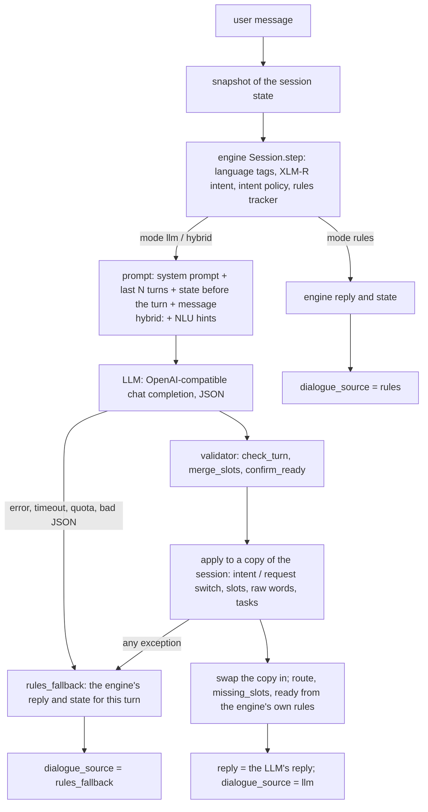

# C1 LLM dialogue layer: design

How `POST /v1/chat` works in `llm` and `hybrid` mode, what the validator allows, how failures are handled, and
the known limits. Setup and commands are in the [component README](../../README.md#llm-dialogue-layer-v1chat).
Code: `service/app/core/` (`dialogue.py`, `validator.py`, `prompts.py`, `llm_client.py`, `settings.py`).

## Why

The rules dialogue (the engine's own replies) moved forward only when it saw certain keywords. In the demo log
(`research/data/regression_rigid_log.json`) it:

- kept `birth_cert_copy` for a driving-licence request, because the intent lock needs a service keyword and
  "licese" (a typo) has none
- sent slot answers through the intent classifier ("school", "business reg purpose")
- filled `purpose` from a keyword list only, so "business reg purpose" was never filled, even when repeated
- could not greet, small-talk, or take several slots from one message

The LLM layer adds natural replies and free-form slot filling **on top of** the engine. XLM-R and the rules tracker
still run on every turn, and the LLM never writes the state: a validator decides what it may change.

## Modes

| `C1_DIALOGUE_MODE` | Reply | State update | NLU hints to the LLM |
|---|---|---|---|
| `rules` (default) | the engine's | the engine's | — |
| `llm` | the LLM's | the LLM's proposals, checked by the validator; the tracker's slot changes are not applied | none (ablation) |
| `hybrid` | the LLM's | the tracker's slot changes, then the LLM's proposals, merged by the validator | XLM-R intent and confidence, tracker intent, entities, tracker slot changes, the tracker's next question |

`/v1/intent` and `/v1/intent/details` are the same in every mode. `/v1/chat` has its own session store, so a chat
never changes what the contract endpoint returns (`service/tests/test_compat_context_v2.py`).

## One turn



Notes:

- The update is applied to a **copy** of the session and swapped in only when everything succeeded, so a failure
  half-way can never leave a broken state.
- If the LLM and the engine agree on the turn's intent (hybrid), the update starts from the engine's state, keeping
  its extras (town → district, "danne na" → `unknown`, confirmed districts). If they disagree, the **validated LLM
  intent wins** and the update starts from the state before the turn, with the tracker's slot extraction for the
  LLM's intent. A sticky XLM-R intent therefore cannot reach the state.
- `route`, `missing_slots` and `ready` come from the engine's own code (`Session._result`), as in rules mode.
- The LLM also says which slot its reply asks for (`asks_slot`). The tracker recognises the bot's question by its
  wording, so the next turn's `bot_text` is the engine's own question for that slot.

### What the LLM gets and returns

The system prompt is generated from the tracker's tables (`INTENT_SLOTS`, the validator's enums, `PURPOSES`,
`ISSUES`, `DISTRICTS`), never written by hand, so the prompt and the validator cannot drift apart. It holds
today's date in Sri Lanka (UTC+05:30) for resolving relative dates. The user content is JSON: the state before the
turn (active intent, slots, unconfirmed slots, missing slots, carried district, tasks, a reply-language hint), the
NLU hints (hybrid only) and the message. The LLM returns:

```json
{"reply": "...", "dialogue_act": "greet|new_request|slot_answer|correction|confirm|deny|chitchat|out_of_scope",
 "active_intent": "<one of the 12 internal intents, or null>", "tasks": ["<unfinished service intents>"],
 "slot_updates": {"slot": "value"}, "slot_raw": {"slot": "<the user's words, for an other value or a date>"},
 "asks_slot": "<slot or null>", "ready_to_confirm": false}
```

## Validator rules (`validator.py`)

**Turn fields** (`check_turn`):

- `active_intent` must be one of the 12 internal intents, else the engine's intent is used (`intent_source:
  nlu_fallback`). `null` means "no request yet" (a greeting) and is not a rejection.
- `dialogue_act` must be one of the eight acts; `tasks` keeps only known intents, without duplicates; an empty or
  overlong reply is replaced by the engine's reply.

**Slot values** (`merge_slots`). A slot must belong to the turn's intent. `null` or empty means "not mentioned" and
is not counted as a rejection.

| Slot | Accepted as |
|---|---|
| `district` | the 25-district gazetteer (English, romanized, Sinhala script), else a known town → its district |
| dates (`date`, `travel_date`, `date_of_birth`) | an ISO date `YYYY-MM-DD` that exists on the calendar; otherwise the date matcher must find a date |
| `applicant_for`, `change_field`, `urgency`, `service_type` | the canonical value or one of its keywords |
| `purpose`, `issue` | the taxonomy value if one matches, else `other` plus the user's words |
| `service_mentioned` | the service gazetteer if one matches, else the text |
| `new_value` | the text |
| any | `unknown` (the user does not know) |

**Conflicts.** When the tracker and the LLM set the same slot to different values on the same turn, the rules value
is kept if it came from an extractive match (district gazetteer / town, date matcher), else the LLM value wins.
Every conflict is logged by slot name only, never its value.

**`applicant_for` protection.** Once known, `applicant_for` changes only when the dialogue act is `correction`.
This always holds for the LLM. For the rules tracker it holds when `C1_PROTECT_APPLICANT_FOR=true` (the default);
the evaluation can turn it off to separate the LLM's effect from this tracker fix.

**Ready.** `ready` is computed from the slots (nothing missing, no unconfirmed carried slot, no pending
which-kind question), never taken from the LLM. `ready_to_confirm` is the LLM's claim and only counts when `ready`.

**Tasks.** A service request the LLM lists that the engine has no open request for is added as pending. The
engine's own open requests are never dropped, and a completed request stays completed.

**Greetings and small talk** with service info still fill slots ("hi, I'm from Galle"). With no request yet, a
district is kept as the conversation's district and offered to the next request as **unconfirmed** ("Still in
Galle?"). The LLM repeating it does not confirm it; the user saying it, giving another one, or answering yes/no does.

## The user's own words (`raw_slots`)

- **"other".** When `purpose` or `issue` matches none of its values, the slot is `other` and the user's words are
  kept in `raw_slots`. The LLM is asked to send them in `slot_raw`. If it sends a bare "other", the user's message
  is used. The prompt tells the LLM never to show internal labels ("other", slot or intent names) to the user.
- **Dates.** The state keeps the ISO date (what C2 would use) and `raw_slots` keeps the user's words for it: the
  date words in `slot_raw`, else those in the message. The evaluation scores dates on the words, because the gold
  labels are the user's words. A date found by the rules tracker in the message wins a conflict and is already words.

## Reply language

The LLM replies in the language and script of the user's message: English → English, Sinhala script → Sinhala
script, romanized Sinhala or Singlish → Singlish. The engine's guess is sent only as `reply_language_hint`, for
messages that do not show their language (a one-word answer such as "Galle"). It is only a hint because of a known
engine issue: a typo in an English message ("licese") can be tagged as Sinhala, so the guess becomes Singlish. Replays
still showed an occasional Singlish reply to English; it did not repeat across runs.

## Failures, retries and fallback

**Live client** (`llm_client.py`; a citizen is waiting, and a failed turn falls back to the rules path anyway):

| Case | What happens |
|---|---|
| 429 whose body says the quota is exceeded | fail at once (a retry burns more quota) |
| other 429 | one retry after the provider's delay (`Retry-After` / `retryDelay`), at most 5 s, else 1 s |
| 500 / 502 / 503 / 504, transport errors | one retry after 1 s |
| timeout, refused connection | fail at once |
| other 4xx | fail at once |
| 400 rejecting JSON mode | one free retry without `response_format`; remembered for the client's lifetime |
| invalid JSON | one repair retry ("return valid JSON only") |

Any failure, from the LLM or from applying its update, makes that turn a `rules_fallback`: the engine's reply and
state, with the exception class (never its message) in `error`. The demo never crashes because of the LLM.

**Evaluation runs** (`dialogue_eval.py`) must not turn a slow provider into a quiet rules turn: rate limits, 5xx,
timeouts and bad JSON wait 30 / 60 / 60 s (or the provider's delay) and retry, then the turn is marked `failed` and
counted as wrong. "Quota exceeded" is retried once after 65 s, then the run stops and resumes from its checkpoint.

Token usage is recorded per call (prompt, completion, reasoning, the provider's total, latency, calls), summed over
a repair retry.

## Hint gating: calibrated on gold, not supported

`C1_HINT_MIN_CONFIDENCE` marks the intent hints "weak" below a confidence. The gate was chosen before any run on the
fresh set, on the gold dialogues (142 turns, held out from XLM-R's training: the intent head of `run_v2_seed1` was
trained on the synthetic silver set, Observation 10, so its confidence there would be inflated), with a rule fixed
in advance: for each
gate on {0.35, 0.4, 0.5, 0.6, 0.7, 0.8}, count the turns below it where XLM-R is wrong (marking them weak helps)
and right (it only costs), and take the gate with the largest wrong − right
(`research/experiments/gate_calibration.py`, `research/results/gate_calibration.json`).

| Gate | Below | Wrong | Right | Net |
|---|---|---|---|---|
| 0.35 | 6 | 1 | 5 | −4 |
| 0.4 | 14 | 5 | 9 | −4 |
| 0.5 | 25 | 7 | 18 | −11 |
| 0.6 | 39 | 9 | 30 | −21 |
| 0.7 | 52 | 14 | 38 | −24 |
| 0.8 | 69 | 16 | 53 | −37 |

No gate has a positive net, so the chosen gate is 0.0 (off) and the gated setting is not evaluated. XLM-R (accuracy
0.852 on gold) is right on most low-confidence turns, and its errors are spread over all confidence levels, so its
confidence cannot tell good hints from bad ones. In the replays of the demo log, every hybrid failure came from a
wrong intent hint: twice the tracker's lock hint, once a confident XLM-R hint (0.61). Gating by confidence would
have caught neither. **Future work:** a weak-hint signal based on XLM-R and the tracker disagreeing, calibrated on
gold the same way.

## Evaluation: design and results

`research/experiments/dialogue_eval.py`; details in its header. Results:
`research/results/dialogue_eval_rules.json`, `dialogue_eval_llm_gemini-3.5-flash-lite.json`,
`dialogue_eval_hybrid_gemini-3.5-flash-lite.json` (22 Oct 2026, 16:19–16:42).

### Design

- The fresh set (23 dialogues, 50 user turns) is the held-out test: the gold set was used to write the rules.
  **Nothing was tuned on it**: the prompt, the validator and the scoring were fixed before the run, the hint gate
  was calibrated on gold, and every change suggested below is future work, not applied.
- `rules` runs once (deterministic); `llm` and `hybrid` run 3 times each (`gemini-3.5-flash-lite`, effort `low`,
  temperature 0), reported as mean [min–max].
- Each turn sees the gold history (gold user and bot turns); the state is always the system's own.
- Scoring reuses `dst_eval.py` (`score_turn`, `summarise_rows`), on the schema slots of the turn's intent. Strict
  scoring is the main number. A secondary "district relaxed" score counts a district inferred from a town as
  correct when the user named the town but no district; the gold labels name districts only where written.
- Also reported: intent-switch accuracy (2 turns: anecdotal), hallucinated slot rate, slot rejection rate,
  fallback / failed rate, NLU and LLM latency, tokens.

### Results (fresh, 50 turns)

| Setting | Runs | JGA (strict) | JGA district relaxed | Slot JGA | Intent acc. | JGA turn 2+ | Slot F1 |
|---|---|---|---|---|---|---|---|
| rules | 1 | **0.800** | **0.880** | **0.800** | **0.920** | **0.741** | **0.838** |
| llm | 3 | 0.673 [0.640–0.700] | 0.727 [0.720–0.740] | 0.747 [0.700–0.780] | 0.880 [0.860–0.900] | 0.580 [0.519–0.630] | 0.800 [0.763–0.842] |
| hybrid | 3 | 0.727 [0.700–0.740] | 0.807 [0.780–0.820] | 0.727 [0.700–0.740] | 0.900 [0.880–0.920] | 0.617 [0.593–0.667] | 0.831 [0.819–0.843] |

| Setting | Hallucinated slot rate | Slot rejection rate | Failed / fallback turns | LLM ms, mean (median) | Tokens per turn (prompt + completion) |
|---|---|---|---|---|---|
| llm | 0.282 [0.258–0.312] | 0.088 [0.061–0.111] | 0 / 0 | 4,146 [3,872–4,572] (≈3,700) | 1,804 [1,796–1,821] (≈1,639 + 119) |
| hybrid | 0.307 [0.294–0.324] | 0.082 [0.081–0.083] | 0 / 0 | 4,367 [3,933–4,890] (≈3,700) | 1,933 [1,918–1,948] (≈1,801 + 117) |

- **Neither LLM setting beats the rules dialogue on state tracking** on the fresh set. Hybrid is ahead of `llm`
  on every accuracy measure (JGA +0.05, district relaxed +0.08). With 50 turns, a difference of a few turns is
  within the run-to-run spread; the gap to rules (0.07 JGA) is about 4 turns per run.
- All 300 LLM calls answered: no failed or fallback turn, no eval retry. The NLU hints cost hybrid about 160 more
  prompt tokens per turn (+7% total tokens). LLM latency was about 4 s per turn (median about 3.7 s), with a few
  very slow calls (up to 40 s, under the 60 s timeout); the NLU part was 0.1–0.4 s.
  - Latency was measured on a shared laptop under variable load (the NLU time rose from 0.11 to 0.36 s per turn
    during the run), so treat the absolute latencies as indicative.
  - The worst case (40 s) is longer than the live default timeout (`C1_LLM_TIMEOUT`, 30 s): in the demo such a turn
    would time out and fall back to the rules reply.
- Dates: `llm` stored 5 ISO dates per run, all scored on the user's words from `raw_slots`; in hybrid the rules
  tracker's date words won every time (7 per run). No date fell back to ISO.

### Error analysis

**Hallucinated slots** (LLM-set slots not in the gold state; all 3 runs together). Most are not real errors:

| Kind | llm | hybrid | Examples |
|---|---|---|---|
| Town → district | 13 | 15 | "Negombo" / "Ja-Ela" → Gampaha; "45/2 Temple rd, Panadura" → Kalutara; "Kottawa North" → Colombo (6 per setting; Kottawa is not in the town gazetteer, so the relaxed score does not cover it) |
| Reasonable value, not labelled in gold | 3 | 11 | "ඒක ඕන ID එක හදන්න" (it's for making the ID) → `purpose=NIC`; "eyata 16 una last week" → a date of birth inferred from the age; "mage passport" / "මගේ ගමන් බලපත්‍රය" → `applicant_for=self` (with the wrong intent, see below) |
| Real error | 10 | 5 | a follow-up question read as `general_question` with an internal intent name as the value (`service_mentioned='nic_new'`); the NIC number "200012345678" as the `new_value` of a photo change; `applicant_for=self` guessed with no "my" in the message; "kasadeta…" → `service_mentioned='kasadeta'` |

**Turns rules got right and hybrid got wrong** (in at least one run): 8. The reverse: 3. For `llm`: 16 and 7.

| Cause | Turns (hybrid wrong in k of 3 runs) |
|---|---|
| Missed intent switch (both switch turns in the set) | the user asks to update their NIC surname during a passport request (2/3); the user reveals the birth certificate is for making an NIC (3/3) |
| Service-naming convention: a lost passport is `passport_renew` | "මගේ ගමන් බලපත්‍රය නැති වුණා" → `passport_new`, two turns (2/3 each) |
| A follow-up question read as `general_question` | "do i need one even if it was just lost?" (1/3) |
| District of a town missing from the gazetteer | "Kottawa North" / "Kottawa East" → Colombo, two turns (3/3) |
| Wrong slot value | the NIC number as `new_value` (2/3) |

Turns hybrid got right and rules got wrong: "**kasadeta** registrar kenek book krnne kohomada" (two turns; rules
read *kasada*, wedding, as an unsupported service, the LLM as marriage registration), and one `applicant_for` turn
(see the confound below).

**Intent switching.** The rules engine caught both switch turns (2/2); the LLM layer mostly missed them (`llm` 0, 1
and 1 of 2; hybrid 1, 0 and 0 of 2): the LLM tends to stay on the open request when the user moves on. With n = 2
this is anecdotal, but it matches the error analysis above.

**Confound: `applicant_for` protection.** In one turn hybrid kept `applicant_for=child` where the rules tracker
switched to `parent` ("thaththa abroad. එයාගේ consent letter…", about the father's consent). That is the
`C1_PROTECT_APPLICANT_FOR` tracker fix, active in hybrid by default, not the LLM. A run with it set to `false`
would separate the two.

**Replays vs evaluation.** On the 10-turn demo log, `llm` scored as well as or better than hybrid in every replay;
on the fresh set, hybrid is ahead of `llm`. Both are small samples with visible run-to-run variation: neither
result alone says whether the NLU hints help.

## Known limits

- **Data protection.** The Gemini free tier may use prompts to improve Google's models, so only fictional data is
  sent (tests, replays, the evaluation sets). Sessions are anonymous (`anon-…`); logs hold no message text or slot
  values.
- **Gemini 3 rejects `reasoning_effort` `none` and `minimal`** (HTTP 400 `INVALID_ARGUMENT`). Development and the
  evaluation use `gemini-3.5-flash-lite` with `low`. Model names are retired over time (404); Gemini 3.8 Flash hit
  free-tier 429 / 503 too often to evaluate.
- **Thinking shows only as unexplained tokens.** Gemini's OpenAI-compatible endpoint reports no
  `reasoning_tokens`, but with effort `low` some turns think: `total_tokens` is then larger than prompt +
  completion (up to about 1,000 extra tokens per turn in the replays), and latency jumps (up to about 9 s).
  Token cost (SO3) is therefore counted from the provider's total (`provider_total_tokens`).
- **Run-to-run variation at temperature 0.** Replays of the same 10-turn log gave hybrid 27, 24 and 25 of 27
  checks. Single runs are anecdotes; the evaluation repeats runs and reports the spread.
- **Hybrid follows wrong hints.** When the tracker's lock or a confident XLM-R prediction is wrong, the LLM sometimes
  follows it; `llm` mode, without hints, does not have this failure (and in the replays scored as well or better).
- **Reply and state can disagree.** The LLM sometimes asks for a slot it has just filled, or declines a service in
  its reply while returning the old intent. The validator checks values, not the reply text.
- **The state carries over with the LLM's choice.** A hallucinated `applicant_for` blocks the right value on the
  next turn, because a known `applicant_for` only changes on a correction.
- **Town → district.** The engine and the LLM fill a town's district ("Panadura" → Kalutara); the gold labels do
  not, hence the district-relaxed secondary score.
- **Not measured: turns to completion.** With gold history a dialogue's length is fixed; measuring it needs a
  simulated user (future work).
- **Sessions are in memory** (30 minutes idle, at most 1,000), as for the contract endpoints.

## Future work

None of these were applied or tuned on the fresh set; each would need its own check on gold or synthetic data
before a new held-out run.

- **Prompt conventions:** say that a lost passport is `passport_renew`, and that a follow-up question inside a
  service request keeps that request's intent (not `general_question`).
- **Intent switching:** combine the rules engine's keyword switching (which caught both switch turns) with the
  LLM's, e.g. let a rules switch override the LLM's intent, or send it as a stronger hint.
- **Weak hints from disagreement:** mark the intent hints weak when XLM-R and the tracker disagree, calibrated on
  gold like the confidence gate.
- **Gazetteer:** add Kottawa-type places (GN divisions, suburbs) to the town list, so their districts are found by
  the rules and covered by the district-relaxed score.
- **`applicant_for` ablation:** run hybrid with `C1_PROTECT_APPLICANT_FOR=false` to separate the tracker fix from
  the LLM.
- **Simulated-user evaluation** for turns to completion and for the dialogue as the user sees it (replies,
  questions asked twice, reply/state agreement), which gold-history scoring cannot measure.
