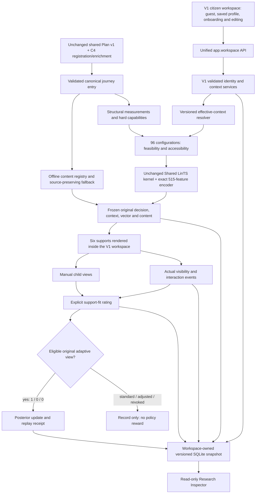

# Integrated C4 PP1 application

The active citizen application is the existing V1 workspace with the V2 policy and six support mechanisms. It is not a third standalone UI. Historical V1 and V2 backend entry points remain for reproducing baselines; do not run them for the integrated demonstration.

## Run one backend and one frontend

Backend, PowerShell terminal 1:

```powershell
Set-Location "C:\Users\Lenovo\Desktop\HelaGuide\components\c4-presentation\service"
$env:C4_WORKSPACE_MODE = "simulation"
$env:C4_WORKSPACE_SEED = "0"
$env:C4_WORKSPACE_DATABASE = Join-Path (Get-Location) ".local\v2\workspace\simulation\state.sqlite3"
$env:C4_LLM_ENABLED = "false"
$env:C4_DEV_LLM_ENABLED = "false"
.\.venv\Scripts\python.exe -m uvicorn app.workspace:app --host 127.0.0.1 --port 8018
```

Frontend, PowerShell terminal 2:

```powershell
Set-Location "C:\Users\Lenovo\Desktop\HelaGuide\components\c4-presentation\demo-frontend"
$env:VITE_C4_API_BASE_URL = "http://127.0.0.1:8018"
node .\node_modules\vite\bin\vite.js --host=127.0.0.1 --port=5173 --strictPort
```

Open http://127.0.0.1:5173/. The former `#c4-v2` citizen address is an alias of this same workspace. The header's Pipeline Inspector opens the separate read-only research view in the same tab. `VITE_C4_V2_API` is no longer used by the active frontend. If a port is occupied, reuse the correct running service or stop its identified process; do not terminate an unidentified process.

Health: GET `http://127.0.0.1:8018/health`. Policy: GET `/v2/policy`. Interactive API documentation: `/docs`. Bind to loopback: this is a local research prototype, not an authenticated public service.

## Implemented architecture



One runtime owns the workspace store. `WorkspaceRuntime` subclasses the existing V2 runtime; it does not introduce a different learning algorithm. The unchanged `_GaussianPosterior` remains the numerical kernel. There is no history-transfer score adjustment.

### Code responsibilities

| Responsibility | C4-owned implementation |
|---|---|
| Main backend | `service/app/workspace.py` |
| Existing identity/onboarding semantics | `service/app/host/demo_profiles.py`, `core/user_context.py`, existing typed models |
| Integration and effective context | `service/app/host/identity.py` |
| Existing workspace API compatibility | `service/app/host/routes.py` |
| Plan validation and canonical graph | Existing `core/procedure_input.py`, `core/procedure_graph.py`; `v2/registration.py` consolidates the validated extension |
| Additional joins, owners, parallel areas | Existing `v2/content.py` typed overlay, embedded in one registration packet |
| Registry, readable labels, preparation jobs | `v2/registration.py`, existing `core/wording_views.py`, `v2/preparation.py` |
| Catalogue, filtering, exact encoder | Existing `v2/catalogue.py`, unchanged `v2/features.py`, existing `v2/measurements.py` |
| Selection, events, views, receipts, recovery | `v2/runtime.py`, extended by `WorkspaceRuntime` |
| Main citizen UI | Existing `src/App.tsx`, `app/useWorkspace.ts`, `profiles/ProfileOnboarding.tsx` |
| Reusable settings editing | `src/profiles/ProfileSettings.tsx` |
| Integrated request and recovery controller | `src/guidance-v2/WorkspaceGuidance.tsx`, `workspaceClient.ts` |
| Six supports and process map | Existing `GuidanceMessage.tsx`, `ProcessMap.tsx`, `semantics.ts`, integrated styling |
| Separate Inspector | `src/guidance-v2/V2App.tsx` now contains only the read-only Inspector |
| Explicit state/profile copying | `service/app/studies/v2_transfer.py` |
| Unified synthetic experiment | `service/app/studies/v2_workspace_experiment.py`, existing `simulation.py` |

### Profiles, context and preference semantics

Continue as Guest uses standard guidance. A saved profile requires explicit personalization enablement for LinTS selection. Onboarding collects familiarity by requested service, a general confidence default, navigation preference and accessibility. Optional editing exposes all six preferences and hard requirements without repeating questions on each request.

The resolver looks up the selected graph's requested service, merges saved settings and validated optional API request overrides, then freezes effective values, origins, resolver version and revisions in the original decision. A default familiarity is never inferred from another procedure. The service identity is authoritative: two fixtures describing the same requested service share its familiarity report.

Soft preferences populate the existing 13 preference indicators. They need learned evidence; they do not force a state or guarantee a particular outcome. Hard locks and accessibility constrain feasibility. Changing them retires outstanding views for that session, blocks their rewards and requires fresh guidance; the UI does not keep showing an incompatible format. The V2 settings endpoint rejects legacy preference/lock fields rather than silently ignoring or reinterpreting them. Request overrides cannot weaken saved accessibility or contradict a saved hard lock. Disabling personalization revokes eligibility for outstanding adaptive journeys; re-enabling does not resurrect those learning permissions.

Explicit native V2 preferences override compatible legacy fields. Compatible V1 navigation is mapped directly; V1 disclosure true means collapsed, so it is inverted into the V2 state vocabulary. Old map, previous-visit recap and prerequisite preferences remain review items. Imported ambiguous hard requirements block guidance from that profile until explicitly reviewed. Essential prerequisites remain visible in every configuration.

### The six supports

- Overview / Guided: scan all actions or focus on one; direct action access remains available. Browsing order is not inferred execution order.
- Concise / Expanded: approved full variants only. Source-preserving concise fallback remains usable when richer variants are missing.
- Collapsed / Expanded supplementary details: independent of explanation depth; optional content remains manually expandable. Unreviewed supplementary passages remain visible.
- None / Inline / Map: required relationships remain in instructions; inline links and the supplied graph add support. The map has enlargement, a narrow-screen text layout, and a complete text equivalent.
- Recap Off / On: summaries of actually viewed preceding actions in this same journey, beside the focused action. Revisit behavior preserves those summaries. Never marks completion.
- Preparation summary Off / On: consolidated supplied facts, conditions and responsibilities. Fees are associated with their stages/actions, never summed across alternatives. Source-only charge qualifications remain in required instructions.

The nominal catalogue remains 96. Capabilities can exclude unavailable states. Incomplete structural coverage excludes unsupported focused/full-map aids; supported relationships are displayed with coverage warnings, never inferred independence. Official examples remain bounded snapshots, not complete government workflows.

### Encoder and policy compatibility

`c4-features-v2.1-515` and its ordering/scaling are unchanged: 416 base context-by-action terms, 35 user-by-procedure terms, 55 targeted three-way terms, 9 scaffold-combination terms. The 416 and 506 ablations remain available. No profile ID or individual-history feature was added.

V1's 656 coefficients are never copied. Compatible V2 coefficients can be explicitly copied only after exact manifest and numerical replay checks. Different mode, seed, dimension, prior or feature fingerprint fails closed. Future changes to feature meanings require a new schema and isolated state.

## Procedure preparation workflow

1. Load existing paired Plan/enrichment inputs, or submit `c4-registration-1.0` to POST `/workspace/procedures` with `plan`, `enrichment`, and optional typed `relationships`.
2. Run existing shared-Plan and C4 semantic validation, canonical graph construction, and overlay evidence/cycle/parallel checks. Shared Plan v1 is unchanged.
3. Produce one canonical journey entry for measurements, capabilities, rendering and diagrams. The base graph and additional verified relationships have a bound structure fingerprint.
4. Resolve V2 reviewed variants and graph-bound V1 prepared demo labels. Prefer approved V2 variants. Titles never expose technical action IDs; fallback headings are source excerpts.
5. Detect missing titles and concise/expanded variants. Startup and registration queue idempotent offline jobs under the workspace database's `preparation/` directory. Ordinary guidance never calls a provider or approves text.
6. Prepare manually or use the existing optional LLM CLI. Generated artifacts remain pending. Review requires a named reviewer, explicit source checking and an integrity digest. Pending registrations are rejected.
7. Publish the reviewed artifact with POST `/workspace/procedures/{procedure_id}/wording`, body `{"artifact": REVIEWED_ARTIFACT}`. The workspace registry validates its digest, source fingerprint and unchanged relationships, then stores it atomically in the workspace snapshot. Future requests use it; existing views retain frozen wording. The same path works for newly registered procedures and survives restart. Versioned new procedure inputs can be registered without overwriting an existing Plan identity. Historical file-based V2 artifacts remain read-only registry inputs, not a second active writer.

Operator commands, from `service/`:

```powershell
# Offline editable template; choose a new output filename.
.\.venv\Scripts\python.exe -m app.preparation.overlay_drafts template --procedure official-nic_amendment-v3 --output .local/v2/workspace/preparation/nic-template.json

# Optional live generation, only with configured provider credentials and explicit authorization.
# Omit this in PP1. It cannot approve content.
.\.venv\Scripts\python.exe -m app.preparation.overlay_drafts generate --procedure official-nic_amendment-v3 --output .local/v2/workspace/preparation/nic-draft.json --confirm-live-request

# After a human checks every source and variant:
.\.venv\Scripts\python.exe -m app.preparation.overlay_drafts review --procedure official-nic_amendment-v3 --input .local/v2/workspace/preparation/nic-draft.json --output .local/v2/workspace/preparation/nic-reviewed.json --reviewer YOUR_REVIEWER_REFERENCE --confirm-source-check
```

Publish after review, PowerShell:

```powershell
$artifact = Get-Content .local/v2/workspace/preparation/nic-reviewed.json -Raw | ConvertFrom-Json
$body = @{artifact=$artifact} | ConvertTo-Json -Depth 100
Invoke-RestMethod -Method Post -Uri "http://127.0.0.1:8018/workspace/procedures/official-nic_amendment-v3/wording" -ContentType "application/json" -Body $body
```

A template must be filled with complete variants before review; it is not automatically approved. Graph/source validation cannot prove natural-language entailment: human source review remains necessary. Existing demo wording is explicitly identified as demonstration content, not falsely labelled independent official validation. Some official procedures currently have source-preserving instructions and prepared labels but no approved full V2 expanded variants; those states stay unavailable and preparation jobs remain pending. The fictional practice fixture supports all six mechanisms and all four depth/disclosure combinations.

## Exact request and learning workflow

1. V1 workspace loads health, procedure catalogue and saved profiles. Select Guest or create/restore a profile.
2. Select a procedure and click Request Fresh Guidance. The browser sends the session identity, procedure, current settings revision and stable request/capability identity. There is no repeated familiarity questionnaire.
3. Resolver retrieves effective context; standard routing avoids a Thompson draw and cannot train. Adaptive routing evaluates 96 configurations, encodes feasible arms and selects the actual maximum under one joint Thompson draw.
4. Persist the original context, vector, sampled parameters, candidates and frozen document. Return a capability-protected journey and original view.
5. Intersection observers acknowledge actual visible actions and controls. Navigation, optional details, map size and recap events remain attributed activity, not inferred rewards or completion.
6. Explicit configuration adjustments create child views. Undo creates another child; it never restores original learning eligibility.
7. A visible eligible original adaptive view accepts About Right=1, Need More=0, Too Much=0, once. No rating means no update. Standard, adjusted or revoked views store ratings without policy rewards. Duplicate events/ratings are idempotent.
8. Persist the posterior receipt, RNG, profiles, settings, journeys and events atomically. Restart replays receipts and verifies the fingerprint. Inspector GET requests do not learn.

## Persistence, import and safety

Default integrated store: `service/.local/v2/workspace/simulation/state.sqlite3`, table `c4_workspace_state`. Participant mode must use its own path and manifest. Never point V1 or historical V2 snapshot writers at this file. The runtime rejects incompatible table ownership and non-workspace target paths.

Profiles retain validated V1 schema/history inside a versioned workspace identity envelope. Native V2 settings and settings events have separate revisions. Effective settings revision includes both legacy context and native edits. Individual interaction evidence remains associated with profile/session, procedure, graph, journey, view and opportunities; PP2 scoring abstains.

Explicit copy tooling defaults to preview only:

```powershell
# Existing V1 SQLite snapshot, or a validated exported RuntimeState JSON for PostgreSQL.
.\.venv\Scripts\python.exe -m app.studies.v2_transfer --source PATH_TO_V1_SNAPSHOT
# Add --target .local/v2/workspace/simulation/profile-copy.sqlite3 --apply-copy only after reviewing the preview.

# Compatible old V2 or integrated experiment state; empty target only.
.\.venv\Scripts\python.exe -m app.studies.v2_transfer --source .local/v2/simulation/state.sqlite3
```

The source SQLite connection uses mode=ro. V1 copies only profiles/context evidence; no V1 posterior is imported. Copied consent starts off. Compatible navigation/disclosure/accessibility are retained, changed meanings require review. Copying profile evidence across simulation/participant modes is rejected. PostgreSQL profile import needs a validated exported snapshot; the tool does not connect to or mutate the original PostgreSQL database.

No branch, commit, original database, or old posterior is automatically changed. Original V1 code remains on `c4/official-procedure-examples`; use its original runtime/environment/storage when reproducing it. This integration does not perform a Git switch to test that branch.

## Controlled experiment

From `service/`, choose an unused output directory:

```powershell
.\.venv\Scripts\python.exe -m app.studies.v2_workspace_experiment --output .local/v2/workspace/experiments/pp1-seed17 --seed 17 --train 40 --evaluation 12
```

This uses saved synthetic profiles, the resolver, actual Shared LinTS selection, display acknowledgements, feedback, updates, saved-model recovery and held-out evaluation. It reuses the original outcome generator. It writes traces and reports for 416/506/515 encoders. No scenario injects a chosen configuration.

Recorded integration run: seed17, 40 training + 12 held-out trials per encoder, repeated with identical numerical results. Expected synthetic rewards: 416=.391189; 506=.355129; 515=.382635; minimal=.663810; rich=.217240; uniform=.387720. All three reload checks passed. The minimal baseline wins. These small simulated outcomes do not validate human benefit, preference effects, or a superior 515 representation. Held-out one-hot rating levels also limit generalization. Earlier V2 evaluation results remain unchanged in V2-VALIDATION.md.

A reload-verified trained copy is already prepared locally at `service/.local/v2/workspace/simulation/trained-pp1-seed17.sqlite3` (515 features, 40 simulated updates). To use it in the same application, stop the current integrated backend, then from `service/`:

```powershell
$env:C4_WORKSPACE_MODE = "simulation"
$env:C4_WORKSPACE_SEED = "17"
$env:C4_WORKSPACE_DATABASE = Join-Path (Get-Location) ".local\v2\workspace\simulation\trained-pp1-seed17.sqlite3"
.\.venv\Scripts\python.exe -m uvicorn app.workspace:app --host 127.0.0.1 --port 8018
```

The frontend and URL do not change. The running seed0 interactive store is separate and has one test rating; it was not replaced by the trained copy. New profiles can be created in the trained store using the same onboarding. Copying a policy is a continuation from a sealed source snapshot; do not train both source and copy as an undifferentiated experiment.

To reproduce that copy into an unused target after training:

```powershell
.\.venv\Scripts\python.exe -m app.studies.v2_transfer --source .local/v2/workspace/experiments/pp1-seed17/full.sqlite3 --target .local/v2/workspace/simulation/trained-demo-copy.sqlite3 --seed 17 --mode simulation --apply-copy
```

## Reproducible 2.5-minute PP1 demonstration

Prepare a demo profile beforehand: NIC familiarity 1, birth-copy familiarity 5, confidence 2, personalization on. Keep advanced choices unset unless demonstrating a stated accessibility requirement.

1. 0:00–0:20: Open the one main workspace. Show guest standard guidance, then select the saved profile. Explain that familiarity belongs to a procedure, not a permanent user category.
2. 0:20–0:45: Request NIC guidance; show readable route labels, conditions and preserved charge qualifications. Select the practice procedure with the same profile; no questionnaire repeats.
3. 0:45–1:15: Request fresh practice guidance. Show its actual chosen supports and Inspector context/candidate scores/515 features. States are learned selections, not scenario rules; any subsequent explicit adjustment is labelled manual.
4. 1:15–1:40: Before changing support, expose an action and rate the original view. Inspector's posterior revision/count/fingerprint change. Inspector refresh itself does not train.
5. 1:40–2:10: Make one explicit support adjustment, navigate earlier/later steps, show recap or enlarge the supplied map. Rate the adjusted view: no further policy update.
6. 2:10–2:30: Show saved-model recovery and the recorded simulation comparison. State the bounded official-source scope, synthetic nature of training and remaining human evaluation.

Selections can vary with RNG and posterior state. Do not promise a specific configuration for a named profile or call manual configuration choices learned behavior.

## Verification and limitations

See UNIFIED-VALIDATION.md for executed tests and screenshots. Local profile aliases are visible research records, not authenticated identities. Public deployment, secure participant identity/consent, live team C2/gateway integration, physical-device/screen-reader testing and real-user evaluation remain external work. No live LLM call was made for this integration.

### Preparation worker update (2026-10-21)

See [PREPARATION-BRIDGE.md](PREPARATION-BRIDGE.md) for the now-connected durable asynchronous worker, dynamic-job CLI and review/publication workflow. PP1 defaults to C4_WORKSPACE_CONTENT_MODE=demo with live generation disabled. Full Map now requires complete structural/parallel coverage; current bounded official examples retain inline aids. This update supersedes earlier limitations about the absent worker/dynamic-job bridge, but does not claim live LLM or human-review validation.
