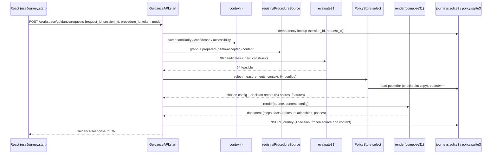
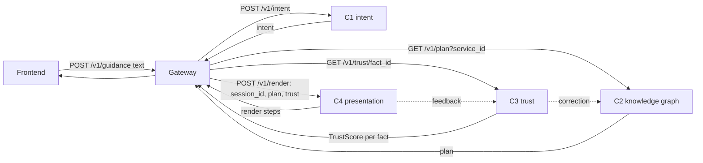
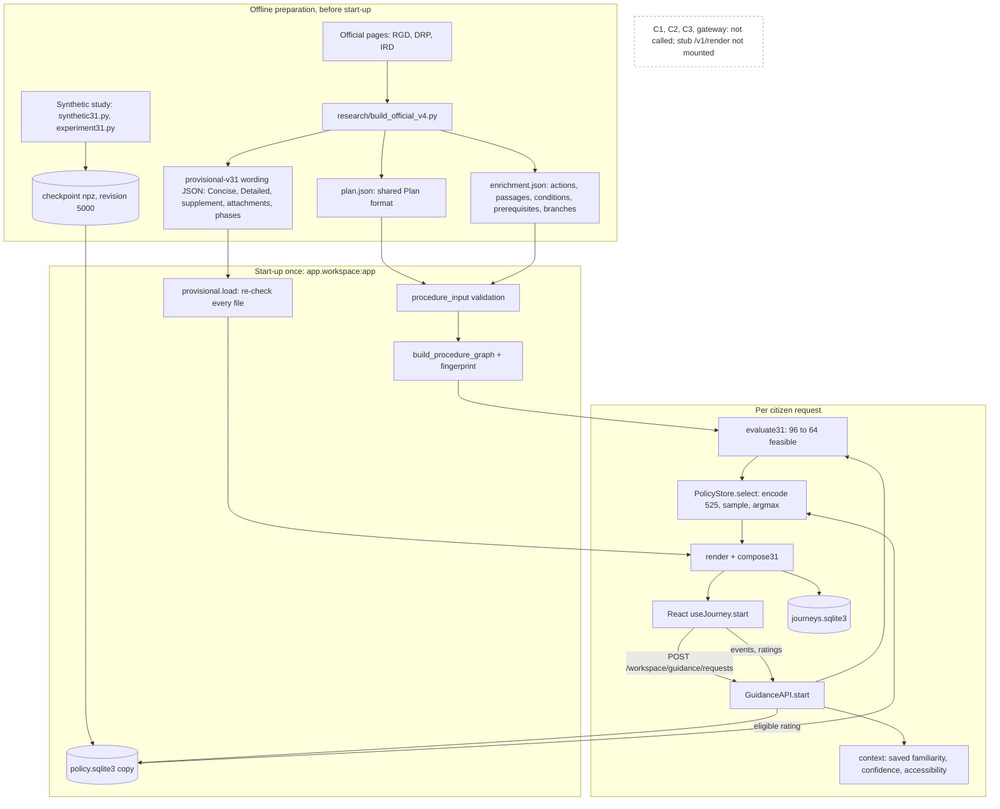

# HelaGuide C4: input/output contract audit and end-to-end explanation

Read-only technical audit of `components/c4-presentation/` on branch `c4/final-official-guidance`. Nothing in the repository was modified to produce the findings; this file is the only deliverable added. Real captures were produced in an isolated, throw-away app instance using a private copy of the trained checkpoint (the original checkpoint's SHA-256 `71a7768f…ace43` was identical before and after; temp folders were removed).

Legend used throughout: **VERIFIED** = read in code, a test or a saved capture. **INTENT** = stated in README/docs as design, not checked as running. **ASSUMPTION** = research framing.

---

## 1. Executive summary

1. **What the repository establishes as the upstream input.** One shared, strict JSON contract: `Plan` (C2 → C4), sent to C4 inside `RenderRequest = {session_id, plan, trust[]}` through the gateway (`contracts/schema/v1/plan.schema.json`, `shared/helaguide_common/contracts.py`). A `Plan` is only: `plan_id`, `requested_service_id`, `generated_at`, `steps[]` (order, service_id, name, agency, one fee, a document list, depends_on) and `provenance` per fact. It has **no** actions, conditions, branches, parallel work, wording, user applicability or uncertainty fields. Uncertainty comes separately from C3 as `TrustScore`.
2. **What the repository does not contain:** the literal message or payload from your team leader. Only the shared contract, its one illustrative example (`contracts/examples/plan.example.json`, a passport plan) and the README flow exist. See section 2.4 for what artifact would be needed for a literal comparison.
3. **What C4 actually consumes today.** No live C2 call. The three demo services are **local files** in `research/data/official/{birth_copy_v4,nic_amendment_v4,tin_registration}/`: a `plan.json` (the unchanged shared `Plan`, strict-validated by the same Pydantic class) plus a C4-owned `enrichment.json` (actions, passages, conditions, prerequisites, branches, evidence). They are loaded at backend start-up, validated, turned into an immutable canonical graph, and measured. Citizen wording comes from `research/data/guidance/provisional-v31/*.json`, loaded and re-checked at start-up and treated as "demo accepted".
4. **What the model does.** A single shared Gaussian linear Thompson sampler (PP1, 525 features, checkpoint revision 5000, exploration 0.25) picks one of the feasible **presentation configurations** (six scaffold settings). It never writes steps or facts. The backend renders the configuration into a `GuidanceResponse`; React only displays it.
5. **Feasible set.** Of 96 theoretical configurations, 64 are feasible for each of the three official services; the map is the only dimension that stays unavailable (parallel coverage is "unknown").
6. **Learning.** Only the original, unadjusted, personalized view can update the posterior, once, after it was displayed and rated.
7. **What is not integrated.** C1, C2 and C3 are not called. `trust` is not consumed anywhere on the live path. The old stub `POST /v1/render` exists in the repo but is not mounted in the running research app.

---

## 2. The original leader/upstream contract

### 2.1 Where it lives (VERIFIED)

| Artifact | Path |
|---|---|
| Flow table and rules ("owned by the whole team") | `contracts/README.md`, root `README.md` §4.4 and §6 |
| JSON Schemas (draft 2020-12) | `contracts/schema/v1/{intent,plan,trust,render,feedback,fact,correction}.schema.json` |
| One valid example per schema | `contracts/examples/*.example.json` |
| Pydantic mirrors | `shared/helaguide_common/contracts.py` (`Plan`, `PlanStep`, `Fee`, `Document`, `Provenance`, `TrustScore`, `Render`, `RenderStep`, `RenderRequest`, `Feedback`) |
| Identifier rules | `contracts/naming.md` |
| Contract change rule | `CONTRIBUTING.md` ("contracts/ is the one place a change can break all four components") |

Flows that involve C4 (from `contracts/README.md`):

| Schema | From → To | When |
|---|---|---|
| `plan` | C2 → C4 | every citizen request |
| `trust` | C3 → C4 | warning on disputed facts |
| `render` | C4 → gateway/frontend | every citizen request |
| `feedback` | C4 → C3 | a citizen reports a problem |

The gateway does the wiring: `gateway/app/clients/services.py` has `get_plan()` (GET C2 `/v1/plan?service_id=`), `get_trust()` and `render()`, which POSTs `{"session_id", "plan", "trust": [...]}` to C4 `/v1/render`.

C4's own README (`components/c4-presentation/README.md`) states the intended C4 contract: inputs are "`plan` from C2; `trust` from C3; behavioural signals from the frontend", outputs "`render` to the gateway and frontend; `feedback` to C3".

### 2.2 The exact data format (VERIFIED)

`shared/helaguide_common/contracts.py`, every model `extra="forbid"` (unknown fields are rejected):

```python
class Fee(_Strict):        value: float (>=0); currency: str; fact_id: str   # pattern ^svc:[a-z0-9_]+:[a-z0-9_]+(:[a-z0-9_]+)?$
class Document(_Strict):   name: str; fact_id: str
class PlanStep(_Strict):   order: int (>=1); service_id: str (^svc:[a-z0-9_]+$); name: str; agency: str
                           fee: Fee; documents: list[Document]; depends_on: list[str]
class Provenance(_Strict): source_url: str; retrieved_at: datetime
class Plan(_Strict):       plan_id: str; requested_service_id: str; generated_at: datetime
                           steps: list[PlanStep] (min 1); provenance: dict[str, Provenance]
class TrustScore(_Strict): fact_id; confidence (0..1); status: "ok"|"disputed"|"verified_correction"; report_count; updated_at
class RenderRequest:       session_id: str; plan: Plan; trust: list[TrustScore] = []
```

All fields of `Plan` and `PlanStep` are **required** (the JSON Schema `required` lists match); there are no optional fields except `trust` (defaults to empty) in `RenderRequest`.

### 2.3 The closest genuine original example (VERIFIED: `contracts/examples/plan.example.json`)

```json
{
  "plan_id": "plan-0001",
  "requested_service_id": "svc:passport",
  "generated_at": "2026-09-16T04:20:11Z",
  "steps": [
    { "order": 1, "service_id": "svc:nic", "name": "National Identity Card",
      "agency": "Department for Registration of Persons",
      "fee": { "value": 0, "currency": "LKR", "fact_id": "svc:nic:fee:first_issue" },
      "documents": [ { "name": "Birth certificate", "fact_id": "svc:nic:document:birth_certificate" } ],
      "depends_on": [] },
    { "order": 2, "service_id": "svc:passport", "name": "Issue of Passport",
      "agency": "Department of Immigration and Emigration",
      "fee": { "value": 11000, "currency": "LKR", "fact_id": "svc:passport:fee:normal" },
      "documents": [ { "name": "National Identity Card", "fact_id": "svc:passport:document:nic" },
                     { "name": "Two passport photographs", "fact_id": "svc:passport:document:photographs" } ],
      "depends_on": [ "svc:nic" ] }
  ],
  "provenance": {
    "svc:nic:fee:first_issue": { "source_url": "https://www.drp.gov.lk/", "retrieved_at": "2026-09-16T04:20:11Z" },
    "svc:passport:fee:normal": { "source_url": "https://www.immigration.gov.lk/pages_e.php?id=8", "retrieved_at": "2026-09-16T04:20:11Z" }
  }
}
```

`contracts/README.md` says examples are illustrative; fee values are placeholders.

**Field by field, in simple English**

| Field | Plain meaning |
|---|---|
| `plan_id` | A label for this one plan. |
| `requested_service_id` | The service the citizen asked for (here: the passport). |
| `generated_at` | When C2 built the plan. |
| `steps` | The services the citizen must complete, one entry per **service** (not per action), listed in order. |
| `steps[].order` | Position in that list (1 first). |
| `steps[].service_id` | Stable id of the service, `svc:<slug>`. |
| `steps[].name`, `agency` | Name of the service and the government body that runs it. |
| `steps[].fee` | One fee for that service: amount, currency and a `fact_id` that never changes even if the amount changes. |
| `steps[].documents` | Documents needed for that service, each with a `fact_id`. |
| `steps[].depends_on` | Which earlier **services** must be done first (`svc:nic` before the passport). |
| `provenance` | For some facts: the web page the fact came from and when it was read. |

### 2.4 What is and is not in the upstream contract (VERIFIED against the model above)

| Item you asked about | In the shared `Plan`? |
|---|---|
| Procedure/service identifier | Yes: `plan_id`, `requested_service_id`, `steps[].service_id` |
| Procedure title | Only as the service `name` of a step; there is no separate plan title |
| Actions or steps | Only **services** as steps; no finer "actions" |
| Step order | Yes: `order` and `depends_on` between services |
| Documents and requirements | Yes: names plus fact ids per service. No role (bring/submit/keep), no applicability condition |
| Conditions and branches | **No** |
| Dependencies | Yes, between services only (`depends_on`); none between actions |
| Agencies and destinations | Agency name per service: yes. Destination/counter/office: **no** |
| Fees | Yes: exactly one fee per service. No alternative or conditional fees, no qualifications |
| Official source references | Yes, but `provenance` is keyed by fact id and not required for every fact |
| Confidence/uncertainty/warnings | Not in `Plan`. Separate `TrustScore` (C3) in `RenderRequest.trust` |
| Parallel activities | **No** |
| User-specific applicability | **No** (C4 gets behavioural signals from the frontend, not from `Plan`) |
| Wording for the citizen | **No** ("Fields, never prose, so C4 can adapt presentation": `plan.schema.json` description) |
| Processing time / eligibility facts | Allowed predicates in `Fact` (`contracts.py`), but not fields of `Plan` |

**Responsibility split (INTENT from README):** C2 builds the dependency-ordered, sourced plan; C3 supplies per-fact trust; C4 decides *how* the plan is presented to this citizen and learns from interaction; C1 only understands the citizen's text.

**What cannot be established.** The repository does not contain the literal message or payload your team leader sent you. The first commit that introduced `contracts/` and `shared/` is `3a2be5d` (2026-09-21, git author handle `malindup2`, "chrore: scaffold the project"); the README names the C2 owner as "T. Malindu Pabasara" and the C4 owner as "Dias K. S. S."; whether either person is the "team leader" is not recorded. For a literal comparison you would need: the leader's actual message/export, the real C2 `/v1/plan` response for one service (or a C2 test fixture), and the gateway's captured `/v1/render` request.

**Separate later C4-owned contracts (VERIFIED):** `ProcedureEnrichment` (`app/models/procedure.py`), registration packet `c4-registration-1.0` (`app/procedures/registration.py: RegistrationPacket`), canonical graph (`app/models/procedure_graph.py`), prepared content `c4-guidance-content-3.1` (`app/guidance/content_v31.py`), the guidance API `c4-guidance-api-1.0` (`app/guidance/frontend_contracts.py`). None of these edit the shared `Plan`: `components/c4-presentation/UNIFIED-README.md` says "Shared Plan v1 is unchanged", and `app/models/procedure.py` imports the very same `Plan` class from `helaguide_common.contracts`.

---

## 3. What C4 actually consumes today

### 3.1 Is there a live C2 call? (VERIFIED: no)

- The running application is `app.workspace:app` (`service/app/workspace.py`), built by `app.host.application.create_app`. It does not import `app.api.routes`, so the stub `POST /v1/render` (`service/app/main.py`, `api/routes.py`, `core/adapter.py`) is **not served**. That stub only turns a `Plan` into a one-line-per-step `Render` and marks disputed facts from `trust`.
- No code in `service/app` calls C2, C3 or the gateway. `trust` is read only in the stub adapter (`core/adapter.py`).
- The frontend never submits a procedure. It sends a procedure **id** (`official-nic_amendment-v4`) and the backend looks that id up in its in-memory registry.
- There *is* an implemented intake for a Plan: `POST /workspace/procedures` with a `RegistrationPacket {plan, enrichment, relationships?}` (`app/host/routes.py:80`, `app/procedures/registration.py: register()`, `WorkspaceRuntime.register_procedure`). It is not used for the three demo services; they are loaded from files at start-up.

### 3.2 The real origin of the three demo procedures (VERIFIED)

| Service | Plan id | Folder (planner inputs) |
|---|---|---|
| Birth certificate copy | `official-birth_copy-v4` | `research/data/official/birth_copy_v4/{plan,enrichment}.json` |
| NIC amendment | `official-nic_amendment-v4` | `research/data/official/nic_amendment_v4/` |
| Taxpayer ID (TIN) | `official-tin_registration-v1` | `research/data/official/tin_registration/` |

These files are generated by `research/build_official_v4.py` (which holds the source-grounded definitions and writes both the planner inputs and the wording). They are read by `app/procedures/official_procedures.py: load_official_procedures(names=OFFICIAL_MAIN)` via `load_registered_procedures()`. The earlier v3 graphs (`birth_copy`, `nic_amendment`, `company_pack`) and four fictional graphs are still registered for regression.

The facts themselves were typed by a person/assistant from the official pages (RGD, DRP, IRD 2026 taxpayer guideline PDF; sources are listed in `docs/C4-MAIN-SERVICES.md`). They were not produced by C2.

### 3.3 Eight layers, and which are incoming vs. built locally

| # | Layer | What it is | Incoming or local | Code |
|---|---|---|---|---|
| 1 | **Upstream/shared Plan** | `plan.json` in the shared format: one `PlanStep` per service, one fee, documents, provenance | Shared contract shape. For the demo, hand-curated locally, not received | `helaguide_common/contracts.py: Plan`; file `plan.json` |
| 2 | **C4 enrichment** | actions, required passages (`content`), evidence anchors, conditions, prerequisites between actions, branch groups, parallel groups, completeness flags, disclaimer | Local, C4-owned. C2 does not provide these | `app/models/procedure.py: ProcedureEnrichment`; file `enrichment.json` |
| 3 | **Canonical procedure graph** | immutable validated snapshot: stages, facts (FeeFact/DocumentFact), actions with applicability, edges, branch groups, evidence, provenance, completeness, fingerprint | Derived from 1+2 | `core/procedure_input.py: parse_procedure_input`, `core/procedure_graph.py: build_procedure_graph`, `core/scaffolds.py: graph_fingerprint` |
| 4 | **Prepared guidance content** | per action: heading, Concise, Detailed, supplement, recap, destination, source wording; per-action document/fee attachments with roles; phases | Local, AI-assisted, cached JSON. Not produced at request time | `research/data/guidance/provisional-v31/*.json`, `app/guidance/content_v31.py: GuidanceContent31` |
| 5 | **Citizen context** | familiarity (1–5 per service), navigation confidence (1–5), preferences, accessibility constraints | Entered in the demo UI, stored by the workspace runtime | `app/host/identity.py: WorkspaceRuntime`, `guidance/frontend_runtime.py: GuidanceAPI.context` |
| 6 | **Interaction history** | journey records and events (`view_displayed`, `navigate`, route choices…), ratings | Local, written during use | `guidance/journey_store.py`, `GuidanceAPI.event/rate` |
| 7 | **Model features** | 525-number vector for each candidate configuration | Computed per request from graph measurements + context + configuration | `guidance/features.py: encode` |
| 8 | **Frontend Guidance Card data** | `GuidanceResponse` JSON | Rendered per request | `guidance/frontend_presentation.py: render`, `frontend_contracts.py: GuidanceResponse` |

### 3.4 Real input objects

The real Plan for NIC (shortened; the file is `research/data/official/nic_amendment_v4/plan.json`):

```json
{
 "plan_id": "official-nic_amendment-v4",
 "requested_service_id": "svc:nic_amendment_card",
 "generated_at": "2026-10-22T09:00:00Z",
 "steps": [{
   "order": 1, "service_id": "svc:nic_amendment_card",
   "name": "NIC amendment: estate and non-estate routes",
   "agency": "Department for Registration of Persons",
   "fee": {"value": 500, "currency": "LKR", "fact_id": "svc:nic_amendment_card:fee"},
   "depends_on": [],
   "documents": [
     {"name": "Completed application (Form D.R.P/1,7,8)", "fact_id": "svc:nic_amendment_card:document:0"},
     {"name": "Previously used National Identity card",   "fact_id": "svc:nic_amendment_card:document:1"},
     "… 9 more documents (11 in total)"]}],
 "provenance": {"svc:nic_amendment_card:fee": {"source_url": "https://drp.gov.lk/en/normal.php", "retrieved_at": "2026-10-22T09:00:00Z"}, "…": "one entry per fact"}
}
```

Notice: **one stage, one fee, a flat list of 11 documents**. That is all the shared contract can say about this service. Everything below is C4's addition.

Real enrichment excerpts (`enrichment.json`):

```json
{"action_id": "action:gn_certify", "service_id": "svc:nic_amendment_card",
 "required_content_ids": ["content:gn_certify", "content:scope"], "supplementary_content_ids": [], "condition_ids": []}

{"content_id": "content:gn_certify", "role": "required", "evidence_ids": ["evidence:amend"],
 "fact_ids": ["svc:nic_amendment_card:document:4", "svc:nic_amendment_card:fee"],
 "text": "If you do not live on an estate, forward the application through the Grama Niladhari for your area of residence, who certifies it. Pay the Rs. 500 amended-card fee through the certifying officer and keep the receipt. Registered-post delivery under the normal service adds Rs. 120."}

{"condition_id": "condition:non_estate", "text": "The applicant is not an estate resident and seeks an NIC amendment.", "evidence_ids": ["evidence:amend"]}
{"prerequisite_id": "prerequisite:1", "kind": "requires_completion", "required_action_id": "action:docs_core", "dependent_action_id": "action:gn_certify", "evidence_ids": ["evidence:amend"]}
{"group_id": "branch:nic_route", "service_id": "svc:nic_amendment_card", "selection": "XOR", "evidence_ids": ["evidence:amend"],
 "options": [{"option_id": "option:estate",     "action_ids": ["action:estate_certify", "action:estate_receive"], "condition_ids": ["condition:estate"]},
             {"option_id": "option:non_estate", "action_ids": ["action:gn_certify", "action:ds_countersign", "action:gn_receive"], "condition_ids": ["condition:non_estate"]}]}
"completeness": {"service_dependencies": "complete", "actions": "complete", "content": "complete", "conditions": "complete", "branch_groups": "complete", "prerequisites": "complete", "parallel_groups": "unknown"}
```

---

## 4. Complete contract comparison

### 4.1 Field-by-field table

| Field or concept | Leader's/shared upstream Plan | Actual C4 runtime source | Transformation in C4 | Used by | Sent to frontend? |
|---|---|---|---|---|---|
| `plan_id` | yes | `plan.json` | unchanged; becomes `procedure_id` and graph `plan_id` | `build_procedure_graph`, registry key, cache key | yes (`procedure_id`) |
| `requested_service_id` | yes | `plan.json` | unchanged | `GuidanceAPI.context` (familiarity is keyed by it), `procedure_title` lookup | yes (`effective_context.service_id`) |
| `generated_at` | yes | `plan.json` | must equal enrichment `base_generated_at` (validated) | `_validate` in `procedure_input.py`; measurement metadata | no |
| Procedure title | only the step `name` | stage whose `service_id` = requested | picked as `title` | `GuidanceAPI.start`, `/procedures` | yes (`procedure_title`) |
| Step (service) | `steps[]` | `plan.json` | becomes a **stage** (`StageNode`) | `core/procedure_graph.py` | yes (`document.stages`) |
| Step order | `order` | `plan.json` | validated unique/sorted → `display_order` | stage graph | yes (stages) |
| Service dependency | `depends_on` | `plan.json` | → `stage_dependencies` edges | measurements (diagnostics), feasibility (`structural`) | yes (`document.stage_edges`) |
| Agency | `agency` | `plan.json` | unchanged on stage; copied onto each rendered action | `frontend_presentation.render` | yes (`actions[].agency`, header) |
| Fee | one `fee` per step | `plan.json` | becomes `FeeFact` (value, currency, fact_id). Which action it appears at is C4's **attachment** | `build_procedure_graph`, `compose31` | yes (`facts[]`, `actions[].facts[]`) |
| Documents | `documents[]` | `plan.json` | become `DocumentFact`; C4 adds a **role** (bring/prepare/submit/keep/pay/charge) and per-action scope | `compose31` | yes (`ScopedFact.role`) |
| Fee/document `fact_id` | yes | `plan.json` | unchanged; used as join key for claims, attachments, evidence | validators, `provisional.check` | yes |
| Provenance | `provenance{}` | `plan.json` | → `FactProvenance` | evidence | yes (`document.provenance`) |
| Actions (finer than services) | **no** | `enrichment.json: actions[]` | → `ActionNode` with `applicability` | everything downstream | yes (`document.actions`) |
| Required source passages | **no** | `enrichment.json: content[]` | → `ContentNode` | coverage proof, measurements (`information_volume`) | partly (`source_wording`, `facts[].source_context`) |
| Evidence anchors | **no** | `enrichment.json: evidence[]` | → `EvidenceNode` | Sources sheet | yes (`document.sources`) |
| Conditions | **no** | `enrichment.json: conditions[]` | unchanged text; effective applicability = action conditions + branch-option conditions | measurements (`condition_count`), routes | yes (`actions[].conditions`, `routes[].options[].conditions`) |
| Action prerequisites | **no** | `enrichment.json: prerequisites[]` | → `ActionPrerequisiteEdge`; DAG and branch rules validated | measurements, `ordering()` layers, feasibility | yes (`document.edges`, `navigation.entries[].layer`) |
| Branch groups | **no** | `enrichment.json: branch_groups[]` | → `BranchGroupNode` (AND/OR/XOR; options sorted by id) | routes, navigation, measurements | yes (`document.routes`, `branches`) |
| Parallel groups | **no** | `enrichment.json: parallel_groups[]` (empty here) | → `ParallelGroupNode` | measurements, map feasibility | yes (`document.parallel`) |
| Completeness flags | **no** | `enrichment.json: completeness` | → `GraphCompleteness` | measurement qualification, feasibility rules | yes (`document.completeness`) |
| Disclaimer / scope | **no** | `enrichment.json: disclaimer` | → `source_limit` | Sources sheet | yes (`document.source_limit`) |
| Heading, Concise, Detailed, supplement, recap | **no** | `provisional-v31/*.json` | stored as drafts; chosen by configuration in `compose31` | `compose31` | yes (`essential`, `explanation_visible/hidden`, `interaction.recap.items`) |
| Destination ("Where") | **no** | `provisional-v31/*.json` (claim bound to a source span) | unchanged text | `compose31` | yes (`actions[].destination`) |
| Fee qualification | **no** | `provisional-v31/*.json` attachments | text bound to a source span | `compose31` | yes (`facts[].qualification`) |
| Phases | **no** | `provisional-v31/*.json: phases` | validated as groups of actions | `evaluate31`, `compose31` | yes (`document.phases`) |
| Trust / warnings | separate `TrustScore` | **not consumed** | – | – | no |
| User familiarity, confidence | **no** | workspace runtime (saved profile) | → `effective_context` → encoder one-hot | `GuidanceAPI.context`, `features.encode` | yes (`effective_context`) |
| Accessibility (guided/map/collapse allowed) | **no** | saved profile settings | → `Constraints{no_guided,no_map,no_disclosure,locks}` | `evaluate31` | yes (`effective_context.constraints`) |
| Preferences | **no** | saved context, default `{}` | one-hot in the encoder | `features.encode` | yes |
| Structural measurements (7) | **no** | computed | graph → counts, normalized | `features.encode` | no (inspector only) |
| Feasible set | **no** | computed | 96 candidates minus reasons | `GuidanceAPI.availability` | yes (`availability.candidates`) |
| Policy decision | **no** | computed (Thompson sampling) | argmax of sampled scores | `PolicyStore.select` | yes (`selection.policy`); scores in inspector |
| `trust.confidence`, `warning` strings | separate | – | – | – | no |

**Categories (as you asked):**

- *Passed through unchanged:* `plan_id`, `requested_service_id`, `generated_at`, `agency`, fee value/currency, document names, `fact_id`s, provenance URLs.
- *Renamed/reshaped:* `PlanStep` → `StageNode`; `Fee`/`Document` → `FeeFact`/`DocumentFact`; plan_id → `procedure_id`.
- *Normalized:* the seven structural measures (`x/(x+scale)`), option/action id ordering (sorted), source-text whitespace.
- *Enriched:* action grain, conditions, prerequisites, branches, evidence, completeness (enrichment); roles, destinations, qualifications (content attachments).
- *Computed from a graph:* layers (`ordering`), measurements, feasibility, routes, navigation, relationship cues, map data.
- *Extracted from source text:* the wording was written from the official pages; claims bind each destination/document/fee to a character span of the passage (`claims[].start/end/quote`).
- *Presentation wording:* heading, Concise, Detailed, supplement, recap (assistant-authored, "demo_accepted").
- *Used only by the ML policy:* the 525-vector, sampled scores, posterior.
- *Used only for feasibility:* `completeness.*`, `Constraints`, claim status, `has_relations`, phases count.
- *Stored for evidence:* graph/relationship/content/feasibility/feature/manifest fingerprints; decision record; events.
- *Not currently used:* `TrustScore`, `Render` (shared) and `Feedback`→C3 contracts; service-level `depends_on` across several services (the three demo plans have a single stage).
- *Missing upstream but supplied by C4:* everything under "no" in the table.

### 4.2 Before/after examples (real, code-backed)

**(a) Fee: from one plan fee to an action-scoped, role-labelled fact**

Before (`plan.json`, step-level): `"fee": {"value": 500, "currency": "LKR", "fact_id": "svc:nic_amendment_card:fee"}`.

C4 adds (provisional content attachment, `research/data/guidance/provisional-v31/official-nic_amendment-v4.json`):

```json
{"id": "attachment:action:gn_certify:fee", "fact_id": "svc:nic_amendment_card:fee", "scope": "action", "action_id": "action:gn_certify",
 "claim_ids": ["action:gn_certify:fee:0"], "role": "pay", "status": "draft",
 "qualification": {"text": "Paid through the certifying officer. Registered-post delivery under the normal service adds Rs. 120.", "claim_ids": ["action:gn_certify:qualification:0"], "status": "draft"}}
```

After (the API's `ScopedFact`, real, from `docs/examples/frontend-api-3.1-main-services-2026-10-22/preview-nic-detailed-on.json`):

```json
{"id": "attachment:action:gn_certify:fee", "fact_id": "svc:nic_amendment_card:fee",
 "fact": {"kind": "fee", "fact_id": "svc:nic_amendment_card:fee", "value": 500.0, "currency": "LKR"},
 "scope": "action", "action_id": "action:gn_certify", "role": "pay",
 "qualification": "Paid through the certifying officer. Registered-post delivery under the normal service adds Rs. 120.",
 "status": "draft", "applicability_status": "consult_source_context"}
```

*Why:* the shared contract can only say "this service costs 500". A citizen needs to know *where* to pay and that the postal charge is separate. C4 binds each statement to a span of the cited source passage and never invents a fee: `app/guidance/content.py: validate_content` rejects an attachment whose claim kind is not `fee`/`document`.

**(b) Document with a condition**

Plan: `{"name": "Attested marriage certificate (using a husband's name or surname)", "fact_id": "svc:nic_amendment_card:document:10"}` (a flat list item; the plan cannot say "only if …").
C4 attachment on `action:docs_extra`: `role: "prepare"`, `qualification.text: "Only if you want to use a husband's name or surname."`, bound to the source span "when using a husband's name or surname".
The UI shows the circumstance directly under that document chip.

**(c) Action and branch**

Plan: one service, no actions. Enrichment: seven actions, one XOR group, five prerequisites (see 3.4). Canonical graph: `action_prerequisites=5`, `branch_groups=1`, which produces `step_count 7`, `dependency_depth 3` in the measurements (section 7).

*Why necessary:* the six scaffolds (navigation, relationships, recap, phases…) need action-level order and branching; a service list cannot support them.

---

## 5. Backend start-up and content preparation

### 5.1 Start-up chain (VERIFIED)

`uvicorn app.workspace:app`:

1. `service/app/workspace.py` reads environment variables: `C4_WORKSPACE_MODE`, `C4_WORKSPACE_DATABASE`, `C4_WORKSPACE_CONTENT_MODE`, `C4_GUIDANCE_CONTENT_SCHEMA`, `C4_PREPARED_CONTENT_ENABLED/MODE/DIRECTORY`, `C4_LLM_ENABLED`, `C4_GUIDANCE_API_ENABLED`, `C4_RESEARCH_PREVIEWS_ENABLED`, `C4_DEMO_ACCEPTED_CONTENT`, `C4_DEMO_PROVISIONAL_CONTENT`, `C4_PP1_POLICY_ENABLED/DIRECTORY/CHECKPOINT/EXPLORATION/SEED/MODE`. It builds `prepared_options` and `guidance_options` and calls `create_app(...)`.
2. `ActiveRuntime(WorkspaceRuntime)` is the `runtime_class`: its `__init__` calls `app.procedures.registration.workspace_registry()`.
3. `workspace_registry()` (`registration.py:101`) → `v2/content.py: registry()` (`:219`) → `core/official_procedures.py: load_registered_procedures()` = fictional graphs (`load_demo_procedures`) + `load_official_procedures()` (v3) + `load_official_procedures(names=OFFICIAL_MAIN)` (the three main services).
4. For each folder: `core/procedure_input.py: load_procedure_input` → `parse_procedure_input` → strict Pydantic validation of `plan` (shared `Plan`) and `enrichment` (`ProcedureEnrichment`) plus semantic checks in `_validate` (unique ids, stage order, DAG/cycle check, a prerequisite may not leave an XOR/OR branch option, parallel claims need complete coverage, evidence kinds, provenance URLs, plan/enrichment timestamp match).
5. `core/procedure_graph.py: build_procedure_graph` builds the immutable `CanonicalProcedureGraph` (facts, stages, branch groups with options sorted by id, edges…). `core/scaffolds.py: graph_fingerprint` hashes it (SHA-256 of canonical JSON).
6. `v2/content.py: procedure()` wraps graph + optional overlay with V2 measurements; `registration.finalize()` adds legacy V2 document fields (title heuristics, preparation status).
7. `app.host.application.create_app` lifespan (`:46`): builds `WorkspaceRuntime` (SQLite `state.sqlite3`, WAL), creates `ContentPreparation` (`guidance/service.py`) with the 3.1 flavour registry, `GuidanceAPI(prepared, **guidance_options)` (`guidance/frontend_runtime.py`).
8. `GuidanceAPI.__init__`: creates `JourneyStore(<prepared dir>/frontend-api)` (SQLite `journeys.sqlite3`), builds `PolicyStore` (SQLite `policy.sqlite3` under `.../pp1-learning/...`, optionally restoring a checkpoint) and, when demo mode is on, `provisional.load()` which re-validates **every** provisional file against its graph and refuses to start if any check fails.

**Once at start-up:** steps 1–8, including Plan validation, graph building, content checking, policy store and manifest checks. **Per guidance request:** context resolution, availability (evaluate31), encoding, scoring, composition, persistence (section 6).

### 5.2 Where content comes from

- **Fictional demos:** installed into the registry from `research/data/guidance/fictional-v31/*.json` by `install_fictional_content31` (draft → review → publish; internally author-reviewed, labelled fictional).
- **Official services:** the registry holds **no** artifact for them. `ContentPreparation.resolve()` (`service.py:121`) finds none, so metadata says `content_state: source_fallback` and it enqueues an idempotent job file. That is why real responses show `job_state: "queued"` although nothing runs: `generation_enabled` is `false`, `C4_LLM_ENABLED=false`, and `prepare()` raises for 3.1 ("prepared offline and reviewed by name; no automatic generation").
- **Demo acceptance:** `GuidanceAPI.availability()` then *replaces* the missing artifact with the content in `self.provisional[pid]` (loaded from `research/data/guidance/provisional-v31/<plan_id>.json`) and relabels the metadata `content_state: "demo_accepted"`, `review_kind: "project_owner_demo_acceptance_automatic_checks"`, `independent_government_validation: false`. Original provenance (`origin: demo_mock`, `review: null`) is preserved in the file.
- **The LLM is never invoked at request time.** The wording was authored with AI assistance beforehand and stored in the JSON. `research/build_official_v4.py` is the source-building script: it holds the facts, passages, actions, wording, and writes both the planner inputs and the wording JSON, then runs `provisional.check`. (`research/build_provisional_content.py` does the same for the v3 services.)
- **Checks (VERIFIED, `guidance/provisional.py`):** `validate_content31` (claim coverage of every required passage, Detailed must keep everything Concise covers, Detailed longer than Concise, supplement carries no required claim and does not repeat the primary text, fact ownership by stage), `grounding_issues` (every number and mid-sentence capitalised name in the wording must occur in the source corpus), `contradiction_issues` (no payment asked where the source says payment is outside, no "free" claim without support, no guarantee).
- **Missing prepared artifact:** the response degrades to `source_fallback`: the exact source passage becomes the essential text, only Concise + Disclosure OFF is feasible (4 configurations), and no supplement/attachments exist.

### 5.3 Schemas, fingerprints and compatibility

| Identifier | Value (current) | Where | Purpose |
|---|---|---|---|
| Action semantics | `c4-scaffolds-v3.1` | `v31_pipeline.ACTION_SCHEMA31` | what the six dimensions *mean* |
| Content schema | `c4-guidance-content-3.1` | `content_v31.SCHEMA31` | shape of prepared wording |
| Render schema | `c4-render-plan-3.1` | `RENDER_SCHEMA31` | composed document |
| API schema | `c4-guidance-api-1.0` | `frontend_contracts.API_SCHEMA` | JSON to React |
| Feature schema | `c4-features-pp1-1.1-525` | `FEATURE_SCHEMA31` | encoder identity |
| Feature fingerprint | `d317181b…fd96baf` | `FEATURE_FINGERPRINT31 = digest({features.SPEC, schema, action})` | encoder layout hash |
| Model manifest | `c4-shared-gaussian-pp1-1.0`, dimension 525, exploration 0.25, noise 1.0, prior precision 1.0, reward centre 0.5 | `v31_pipeline.manifest31` | what a checkpoint must declare |
| Manifest fingerprint | `77bb028e…5d0620` | `digest(manifest)` | stored in every decision |
| Graph fingerprint | per procedure | `graph_fingerprint(graph)` | exact graph snapshot |
| Cache key | `digest({procedure, graph fp, relationship fp, language, schema})` | `cache_key31` | registry lookup |
| Feasibility fingerprint | `d6127808…29ef98` (NIC) | `feasibility_fingerprint()` | hash of the whole feasible set + reasons |
| Content fingerprint | `0dc7fb5e…7c3d8` (NIC provisional) | `GuidanceContent31.fingerprint` | recorded in decisions |

`Model.restore` (`guidance/policy.py`) refuses a checkpoint whose embedded manifest differs from the expected one (action, feature fingerprint, content schema, exploration, dimension…), and `PolicyStore` refuses a state directory whose manifest differs. Changing prepared wording changes the content fingerprint but not the manifest; changing action semantics or the encoder changes the manifest and makes the checkpoint unusable.

### 5.4 Files and databases

| Store | Path (from `workspace.py` / run guide) | Contents |
|---|---|---|
| Planner inputs | `research/data/official/*/{plan,enrichment}.json` | graph sources (read-only at runtime) |
| Demo wording | `research/data/guidance/provisional-v31/*.json`, `fictional-v31/*.json` | prepared content (read-only at runtime) |
| Workspace state | `service/.local/v2/workspace/<name>/state.sqlite3` | profiles, sessions, saved context/settings, preparation queue |
| Prepared registry | `service/.local/prepared-content/<name>/v31/registry.sqlite3` | published fictional artifacts; job files under `v2/jobs` |
| Journeys | `.../v31/frontend-api/journeys.sqlite3` | frozen guidance views, events, receipts (checksummed) |
| Policy | `service/.local/pp1-learning/<run>/policy.sqlite3` | posterior (`precision`, `b`, revision), manifest, updates table |
| Trained checkpoint | `service/.local/pp1-learning/v31-study-20261022-a/seed-23-x0.25-525-n5000.npz` | initial posterior; copied into the policy store at first start, never written |

---

## 6. End-to-end request flow

### 6.1 The citizen click (VERIFIED: NIC, personalization ON, familiarity 1, confidence 1)

Setup that exists before the click: a demo profile with familiarity 1 for `svc:nic_amendment_card`, confidence 1 and personalization ON. The frontend stores `session.session_id` (an identity session like `guest:<hex>` even for profiles) and selects the procedure.

**React path:** `demo-frontend/src/citizen/Workspace.tsx` `Stage` → button `onClick={() => void journey.start({ kind: personalised ? 'personalized' : 'standard' })}` (label "Request fresh guidance" once a response exists) → `useJourney.ts: start()` builds `base = {request_id: newId(), session_id, procedure_id, capability_token: newToken()}` → `api.start({...base, mode: 'personalized'})` → `citizen/api.ts: GuidanceApi.start` → `fetch POST {API_BASE}/workspace/guidance/requests`.

### 6.2 Exact request

`POST /workspace/guidance/requests` (model `StartGuidance`, `frontend_contracts.py`):

```json
{
  "request_id": "f64cf5e0d3f642ac9d69fa9c27f77f78",
  "session_id": "guest:d90911e871e3499f86cdd7b446642f40",
  "procedure_id": "official-nic_amendment-v4",
  "capability_token": "<32–128 chars, generated by the browser, kept in sessionStorage>",
  "mode": "personalized"
}
```

Not sent: familiarity, confidence, accessibility. Defaults `language: "en"` and `context: {}` apply. The server reads the **saved** context itself (`GuidanceAPI.context`): familiarity from the saved service report for `service_id = graph.requested_service_id`, confidence from the saved navigation capability, accessibility from the saved settings, preferences from the native settings (default `{}`). `effective_context.sources` in the response records this: `"familiarity": "saved_service_report"`, `"confidence": "saved_navigation_default"`. A request may override with `context: {familiarity, confidence, preferences, constraints}`; hard constraints can only tighten saved locks.

URL parameters: none for this call. Related calls: `GET /workspace/guidance/context/{session_id}?procedure_id=…` (reads context), `PATCH /workspace/guidance/profile-context/{session_id}` (saves familiarity/confidence/accessibility), `GET /workspace/guidance/procedures/{id}/availability?session_id=…`.

### 6.3 Backend function chain (VERIFIED order; your sequence corrected where marked)

Entry: `guidance/frontend_api.py: start()` route → `GuidanceAPI.start(body)` (`frontend_runtime.py:171`).

| # | Stage | Function | Input → output | Stored |
|---|---|---|---|---|
| 1 | Receive/validate | FastAPI + `StartGuidance` | JSON → typed body (extra fields forbidden; token 32–128 chars) | – |
| 2 | Idempotency | `start()` opens `store.transaction()` and looks up `(session_id, request_id)` | same id + same signature returns the stored journey; different data → 409 | `journeys` table |
| 3 | Policy availability | `start()` | personalized but no policy → 503 `revised_policy_unavailable` | – |
| 4 | Context | `GuidanceAPI.context(sid, pid)` | session + procedure → `effective_context` (familiarity, confidence, preferences, `Constraints`, revisions) via `runtime.settings()`, `runtime.session()`, `store.settings()` | – |
| 5 | Procedure | `source(pid)` → `ContentPreparation.source(pid)` | id → `ProcedureSource(graph, overlay)` from the in-memory registry; `validate()` | – |
| 6 | Content | `availability()` → `ContentPreparation.resolve()`; demo mode swaps in `self.provisional[pid]` | → `(source, content, metadata)` | – |
| 7 | Candidates + hard filter | `flavour.evaluate` = `content_v31.evaluate31(source, content, constraints, assume_reviewed=True)` | 96 `Configuration`s → reasons per candidate (section 9) | – |
| 8 | Select | personalized: `PolicyStore.select(db, measurements(graph, overlay), context, feasible_configs)` | see below | decision record |
| 9 | Compose | `frontend_presentation.render(source, content, config, constraints, compose_fn=compose31)` | config → `document` + reminders | – |
| 10 | Interaction | `navigation(source, doc, interaction)` | initial active step | – |
| 11 | Persist | `INSERT INTO journeys` with a checksum; journey body holds `source`, `content`, `decision`, `views`, `interaction`, `availability` | frozen journey | `journeys.sqlite3` |
| 12 | Return | `_response(journey)` → `GuidanceResponse.model_validate_json` | → JSON | – |

Inside step 8, `PolicyStore.select` (`guidance/policy.py:154`): `_load(db)` restores the posterior (`Model.restore`, manifest check) → `seed = SeedSequence([store_seed, decision_counter])` → `matrix = [features.encode(measurements, context, c) for c in configs]` (64 rows × 525) → `Model.score(matrix, seed)` samples θ̃ once and takes `argmax(0.5 + X·θ̃)` → increments the decision counter → returns `(config, record)`; `start()` then adds `content_state, content_schema, action_schema, feasibility_fingerprint, content_fingerprint` to the record.

**Corrections to the sequence you listed:**

- There is no "PresentationSpec" object on this path. `PresentationSpec` (`app/models/presentation.py`, `core/presentation.py`) belongs to the older V1/V2 flow. The live equivalent is the `Configuration` (six fields) plus the dict composed by `compose31`.
- "Determine support capabilities" and "generate theoretical candidates + apply hard feasibility" are **one** function, `evaluate31`, and capability caps in the V2 `document['capabilities']` are not used by the 3.1 path.
- The structural measurements are computed **inside** `select()` (`measurements(source.graph, source.relationships)` is passed in), and the registry also holds a V2 `measurements` for legacy documents; the policy path calls `app.procedures.measurements.measurements`.
- Persisting the decision happens in the journey insert (step 11), not in a separate decision store; the posterior counter increments inside the policy DB attached to the same transaction.
- Guest/standard/preview requests skip step 8: standard takes the first feasible configuration (`Configuration()`, the all-baseline setting when feasible); previews use the researcher's configuration.

**Implemented but not called by this request:** the stub `/v1/render` + `core/adapter.py`; `PreparationProcessor` LLM generation (disabled); `core/policy.py: SharedLinTSPolicy` (V2/PP0 path); `v2/simulation.py` and the study runners (`experiment31.py`, `synthetic31.py`) which are used offline for training/evaluation; V2 `document['capabilities']`.

### 6.4 Sequence diagram



---

## 7. Procedure graph and structural features

### 7.1 The distinctions

- **Step/stage (service):** one entry in the shared `Plan.steps` (here exactly one per procedure).
- **Action:** a finer unit C4 adds (a thing the citizen does). `step_count` counts **actions**, not stages (`core/procedure_features.py` module docstring).
- **Dependency:** an explicit `requires_completion` edge between two actions.
- **Branch group:** a choice among options: `AND` (all), `OR` (some), `XOR` (exactly one); each option lists its actions.
- **Parallel group:** a set of actions the source states may proceed independently. None exists in the three official services.

### 7.2 The seven measurements (VERIFIED: `models/procedure_features.py: FEATURE_NAMES`, `core/procedure_features.py: extract_structural_features`)

Order: `step_count, information_volume, branch_count, condition_count, dependency_count, dependency_depth, parallel_group_count`. Each is a `FeatureMeasurement {observed, completeness, scale}` with `normalized_observed = observed/(observed+scale)`, `exact_value` and `normalized_exact` only when `completeness == "complete"`. Scales are fixed engineering constants (`NormalizationScales`): 10, 200, 3, 5, 10, 5, 3, not learned.

| Measure | What it measures | How computed | Depends on | Completeness flag combines |
|---|---|---|---|---|
| `step_count` | number of actions | `len(graph.actions)` | enrichment `actions` | actions |
| `information_volume` | how much the citizen must read | sum of lexical units (NFC letter/number runs) of stage name+agency, required passages, supplementary passages, condition texts, plus fact units (document name units; fee = 1 + currency units) | plan + enrichment text | actions, content, conditions, branch_groups |
| `branch_count` | number of branch groups (not paths) | `len(graph.branch_groups)` | `branch_groups` | actions, branch_groups |
| `condition_count` | distinct conditions in force | actions' effective conditions ∪ branch-option conditions | `conditions` | actions, conditions, branch_groups |
| `dependency_count` | explicit action prerequisites | `len(graph.action_prerequisites)` | `prerequisites` | actions, prerequisites |
| `dependency_depth` | longest prerequisite chain in edges | DAG longest path (`_longest_path_edges`) | `prerequisites` | actions, prerequisites |
| `parallel_group_count` | stated parallel groups | `len(graph.parallel_groups)` | `parallel_groups` | actions, parallel_groups |

A combined flag is `unknown` if any input is unknown, else `partial` if any is partial, else `complete`. **Missing data is never turned into zero silently:** an `unknown` measurement keeps `observed` but exposes no exact value, and the encoder gives it separate `partial.*/unknown.*` flag features and zeroes its "complete" copy (`features.encode`: `complete = x if complete else 0`).

Diagnostics outside the seven (stage count, AND/OR/XOR group counts, option counts, content/fact reference counts, `information` breakdown) are in `StructuralFeatures.diagnostics`; V2 measurements (`v2/measurements.py`) additionally count overlay joins/parallel areas (none for these services).

### 7.3 Actual values (computed from the current registry by `app.procedures.measurements.measurements`; also saved in `docs/C4-MAIN-SERVICES-STRUCTURE.json`)

| Measure (observed → normalized; flag) | Birth copy v4 | NIC amendment v4 | TIN v1 |
|---|---|---|---|
| `step_count` | 6 → 0.375 complete | 7 → 0.412 complete | 6 → 0.375 complete |
| `information_volume` | 429 → 0.682 complete | 579 → 0.743 complete | 635 → 0.761 complete |
| `branch_count` | 1 → 0.250 complete | 1 → 0.250 complete | 1 → 0.250 complete |
| `condition_count` | 2 → 0.286 complete | 2 → 0.286 complete | 3 → 0.375 complete |
| `dependency_count` | 5 → 0.333 complete | 5 → 0.333 complete | 3 → 0.231 complete |
| `dependency_depth` | 2 → 0.286 complete | 3 → 0.375 complete | 1 → 0.167 complete |
| `parallel_group_count` | 0 → 0.000 **unknown** | 0 → 0.000 **unknown** | 0 → 0.000 **unknown** |
| stages / XOR groups / options | 1 / 1 / 2 | 1 / 1 / 2 | 1 / 1 / 3 |

Information breakdown (lexical units): Birth stage 9, required 370, supplementary 0, conditions 37, facts 13; NIC 12, 412, 46, 22, 87; TIN 9, 497, 0, 19, 110. For comparison, the earlier v3 NIC had 3 actions / 1 prerequisite (`docs/C4-MAIN-SERVICES-STRUCTURE.json`).

### 7.4 How measurements affect behaviour

- **Eligibility:** only completeness flags matter. `evaluate31` requires `actions, conditions, prerequisites, branch_groups, service_dependencies` all "complete" (`structural`) for guided navigation and maps, and a map additionally needs `parallel_groups == "complete"`.
- **Model features:** all 14 normalized values (observed and complete copies) and 14 partial/unknown flags enter the encoder (section 8). Because `parallel_group_count` is `unknown` for all three, its "complete" copy is 0 and its `unknown` flag is 1.

---

## 8. Shared LinTS internals

### 8.1 Simple English first

The system must choose one of up to 96 ways to *show* the same government instructions. It cannot know in advance which way suits a given citizen, so it behaves like a careful experimenter: it keeps a belief about how well each feature of "citizen + procedure shape + presentation choice" predicts that people say "fits". For each request it draws one plausible version of that belief (Thompson sampling), scores every allowed presentation with it, and shows the best-scoring one. After a genuine "Fits"/"Does not fit" it sharpens the belief. One policy serves all procedures because procedure shape (the seven measurements) is part of the input; there is no model per procedure.

It does **not** write steps, wording, fees or requirements. It only picks a **presentation configuration** from the feasible set.

### 8.2 Technical

- **Why a contextual bandit:** one decision per request, feedback only for the option shown, citizen/procedure context changes the best option.
- **One policy:** one `Model` with one 525-dimensional Gaussian posterior (`guidance/policy.py: Model`, `core/policy.py: _GaussianPosterior`).
- **Feature vector** (`guidance/features.py`, SPEC `c4-features-pp1-1.0-525`; the 3.1 profile relabels it `c4-features-pp1-1.1-525` with a new fingerprint but the same layout):
  - Context `x` has 52 entries: 7 `observed.*`, 7 `complete_value.*`, 14 `partial.*/unknown.*` flags (7 measures × 2), familiarity one-hot over ratings {1,2,3,4,unset} (5; rating 5 is the reference), confidence one-hot (5), 13 preference indicators (one per allowed preference value), 1 intercept. 7+7+14+10+13+1 = 52.
  - Action vector `a` has 8 entries: guided, detailed, disclosure_on, inline, map, recap, segmentation, intercept (`action_values`).
  - Blocks: **(1)** the outer product `x ⊗ a` = 52×8 = **416**; **(2)** 7 context-pair interactions × 5 ratings = **35**, e.g. `familiarity.k * complete_value.dependency_depth`; **(3)** 13 triples × 5 ratings = **65**, i.e. rating × structure × scaffold (e.g. `familiarity.k * complete_value.dependency_depth * guided`); **(4)** 9 scaffold-pair products = **9** (e.g. guided×inline). Total 416+35+65+9 = **525**.
  - Each block is divided by `√(block bound)` (`SCALES = (161, 7, 10, 6)`), the concatenation is divided by 2, and `encode` raises if any value is non-finite or the norm exceeds 1. So **action-context interactions are included**, and identity and history are not inputs.
- **Posterior:** Gaussian with precision matrix `A` (525×525, initial `I`, prior precision 1) and vector `b`, mean `μ = A⁻¹b` via Cholesky. Stored in the checkpoint as `precision`, `b`, `revision` and the manifest JSON (`Model.state`, `np.savez`); in the policy database as the `posterior` row (`state` blob, `counter`, `run`).
- **Thompson sampling** (`_GaussianPosterior.sample`): draw `z ~ N(0, I)` with PCG64 seeded from `SeedSequence([store_seed, decision_counter])`; `θ̃ = μ + c · L⁻ᵀ z` where `A = L Lᵀ` and `c = exploration_scale`. `θ̃` has covariance `c² A⁻¹`.
- **Score:** `s_i = 0.5 + x_iᵀ θ̃` for every feasible candidate `i` (reward centre 0.5). The posterior mean and a posterior std (`√(x_iᵀ A⁻¹ x_i)`, not multiplied by `c`) are recorded for the inspector. The selected configuration is `argmax_i s_i`. Scores are not probabilities.
- **Exploration value 0.25:** the factor `c` above. `1.0` is a full posterior draw; `0.25` shrinks the random perturbation to a quarter, so choices stay close to the posterior-mean favourite (exploit more, explore less). It was chosen on development cases in the synthetic study (`docs/PP1-V31-RESULTS.md` §4) and is written into the manifest; a checkpoint with another value would be refused.
- **Update** (`_GaussianPosterior.observe`, `PolicyStore.update`): with the stored feature vector `x` of the *shown* configuration and reward `r ∈ {0,1}`: `A ← A + xxᵀ/σ²`, `b ← b + x (r − 0.5)/σ²`, σ = 1; re-factorize; revision +1; `pp1.updates` row inserted with the journey id as primary key.
- **Checkpoint contents:** `precision`, `b`, `revision` (5000), manifest. It was trained offline by the synthetic study (5,000 simulated observations, seed 23, exploration 0.25). The live demo restores it into a **new** policy folder, so live feedback never changes the original file.
- **Revisions:** `posterior_revision` starts at 5000 and advances by one for each accepted feedback update.
- **PP2:** history-based score adjustment is **deferred**; the inspector returns `pp2_history_adjustment: "not_implemented"` and `GET /status` says `history_adjustment: "deferred_to_PP2"`.

### 8.3 Decision shown for the two citizens (real, isolated run; section 14)

---

## 9. The six scaffolding dimensions

Backend model: `guidance/catalogue.py: Configuration` (6 fields, defaults overview/concise/off/none/off/off) and `DIMENSIONS`; semantic label `c4-scaffolds-v3.1`. Frontend type: `citizen/types.ts: Configuration`.

| Dim | Values | Backend field(s) | Frontend consumer | Visible effect | Needs | Can be unavailable because |
|---|---|---|---|---|---|---|
| D1 Navigation | Overview / Guided | `configuration.navigation`; `interaction.navigation` | `GuidanceCard.tsx` (Overview list vs. Guided one-step panel, Next/Back, Steps list) | whole procedure vs. one step at a time | ≥2 actions, `structural` complete | `navigation:insufficient_structure_or_accessibility` (`no_guided`) |
| D2 Explanation | Concise / Detailed | `configuration.explanation`; chosen text in `actions[].essential` | `StepParts.tsx: StepBody` | short vs. richer **primary** text | Concise and Detailed for every action | `explanation:reviewed_detailed_missing` |
| D3 Disclosure | OFF / ON | `configuration.disclosure`; `explanation_visible` vs `explanation_hidden`; `disclosure_available` | `StepBody` ("More guidance"/"Less guidance" button) | OFF: supplement shown; ON: supplement behind the button; **primary text always visible** | ≥1 action with a supplement that adds information | `disclosure:no_reviewed_supplement`, `disclosure:accessibility` (`no_disclosure`) |
| D4 Relationships | none / inline / map | `configuration.relationships`; `relationship_aid{mode,inline_by_action,map}` | `StepBody` cues (inline), `ProcessGraph.tsx` (map), `Routes.tsx` | "Before this: …" cues; a graph with a text version | any supplied edge/branch (`has_relations`); map needs `parallel_groups` complete | `relationships:no_supplied_relationships`, `relationships:incomplete_map_or_accessibility` |
| D5 Recap | OFF / ON | `configuration.recap`; `interaction.recap{enabled,items,empty_reason,label}` | `GuidanceCard.tsx` recap aside | reminders of *viewed* earlier steps, "viewed, not confirmed as done" | >1 action and a recap text per action; server-recorded visits | `recap:reviewed_reminders_missing` |
| D6 Segmentation | OFF / ON | `configuration.segmentation`; `document.phases`, `phase_order` | `GuidanceCard.tsx` phase headings (`cz-phaselabel`) | grouped phase headings | ≥2 phases partitioning all actions; branches not split unless a note exists | `segmentation:reviewed_meaningful_groups_missing` |

D2/D3 under v3.1 (VERIFIED in `compose31`): `essential = primary_field.text` (the selected Concise or Detailed text) is always returned and always displayed. The separate supplement goes to `explanation_hidden` when `disclosure == "on"` and the action is disclosable, otherwise to `explanation_visible`. The four combinations are independent.

**Candidate generation and filtering:** `CATALOGUE = product(*DIMENSIONS.values())` = 2×2×2×3×2×2 = 96 (`catalogue.py`). `evaluate31` appends textual reasons to a candidate; no reasons means feasible. Hard locks (`Constraints.locks`) and accessibility flags are authoritative.

**Policy selection vs. manual adjustment:** the trained policy selects the original configuration only for `mode: "personalized"` with personalization enabled. Manual "Support" changes call `POST /journeys/{id}/views` (`GuidanceAPI.adjust`), re-run `evaluate31`, create a child view with `selection.kind = "manual_adjustment"`, set `ever_adjusted = true`, and never train.

**Feasible counts today (VERIFIED, `docs/C4-MAIN-SERVICES-LIVE.json`):** for each of Birth, NIC and TIN, 4 configurations with no prepared content (source fallback) and **64** with demo-accepted content. Remaining restrictions: map (parallel coverage unknown). Phases are feasible for all three; Concise/Detailed, Disclosure, inline connections and recap are feasible.

---

## 10. Complete API request example

See 6.2. Related request bodies, all `frontend_contracts.py` models:

```jsonc
// Save settings (fix for the earlier 409; expected_identity_revision comes from GET /context -> revision.identity)
PATCH /workspace/guidance/profile-context/{session_id}
{"request_id": "…", "expected_identity_revision": 2, "familiarity": [{"service_id": "svc:nic_amendment_card", "score": 4, "source": "self_reported"}], "confidence": 4, "accessibility": {"allow_guided_navigation": true, "allow_relationship_visuals": true, "allow_collapsed_content": true}}

// Event (interaction, never training)
POST /workspace/guidance/journeys/{journey_id}/events    (header X-C4-Token)
{"event_id": "…", "view_id": "view:…", "type": "view_displayed", "action_ids": ["action:docs_core"]}

// Manual adjustment
POST /workspace/guidance/journeys/{journey_id}/views
{"request_id": "…", "parent_view_id": "view:…", "configuration": {"navigation": "overview", "explanation": "concise", "disclosure": "off", "relationships": "none", "recap": "off", "segmentation": "off"}}

// Feedback
POST /workspace/guidance/journeys/{journey_id}/ratings
{"event_id": "…", "view_id": "view:…", "rating": "fits", "reasons": []}
```

---

## 11. Complete API response example

Response model: `GuidanceResponse` (`frontend_contracts.py`), returned by `POST /workspace/guidance/requests`, `/research/previews`, `GET /journeys/{id}` and `POST /journeys/{id}/views`.

The captured response is ~170 KB because it contains all 64 candidates and all facts again inside every action. The listing below is the **real** response (NIC, familiarity 1, confidence 1, a genuine policy decision from the isolated run), **elided mechanically**: every list longer than 2–3 items is cut with a marker, long strings are truncated at 360 characters, and the duplicated `source_context` passages are removed. Every key and nesting level present in the real response is shown. The unabridged equivalents are stored in `docs/examples/frontend-api-3.1-main-services-2026-10-22/personalised-nic-novice-rich.json` (a same-shape captured response from an earlier run).

```json
{
 "schema_version": "c4-guidance-api-1.0",
 "journey_id": "guidance:febad19c434a4743b222a219ff85deec",
 "view_id": "view:71c918c74899417b9078c7251baddf10",
 "parent_view_id": null,
 "session_id": "guest:d90911e871e3499f86cdd7b446642f40",
 "procedure_id": "official-nic_amendment-v4",
 "procedure_title": "NIC amendment: estate and non-estate routes",
 "created_at": "2026-10-22T07:56:46.748553Z",
 "selection": {
  "kind": "shared_gaussian_lints",
  "configuration": {
   "navigation": "guided",
   "explanation": "detailed",
   "disclosure": "on",
   "relationships": "none",
   "recap": "on",
   "segmentation": "on"
  },
  "action_schema": "c4-scaffolds-v3.1",
  "label": "Personalized guidance - Shared Gaussian LinTS",
  "scoring_status": "executed",
  "policy": {
   "algorithm": "shared_gaussian_lints",
   "action_schema": "c4-scaffolds-v3.1",
   "encoder_schema": "c4-features-pp1-1.1-525",
   "model_manifest_fingerprint": "77bb028ef16de1528833746f91f5692ec19306a9b3c394c3f18eb584905d0620",
   "policy_run_id": "pp1-run:2cf82b52d3c742b79d80230c61739674",
   "posterior_revision": 5000,
   "decision_id": "decision:e7d0579d960a42d8bb37c4f3ed96d01f",
   "training_provenance": "synthetic"
  },
  "learning_eligible": true,
  "explanation": "Maximum sampled score among feasible configurations; scores are not probabilities."
 },
 "preparation": {
  "content_state": "demo_accepted",
  "preparation_state": "draft",
  "job_state": "queued",
  "job_id": "9a7759cfb5452611cb339d6c1179bb302edd8ce5d9303dacd4fa93c4d6d7a21e",
  "error_code": null,
  "generation_enabled": false,
  "mode": "demo",
  "language": "en",
  "fallback_language": "source_language",
  "content_schema": "c4-guidance-content-3.1",
  "artifact_id": null,
  "review_kind": "project_owner_demo_acceptance_automatic_checks",
  "source_kind": "bounded_official_source_snapshot",
  "content_origin": "demo_mock",
  "source_review": {
   "reviewer": "LOCAL RESEARCH DEMO: accepted for demo use by the project owner. AI-assisted wording checked by automatic source-grounding checks only; no external expert, government or independent review.",
   "reviewed_at": "2026-10-22T07:56:46.674541Z",
   "scope_note": "Demo acceptance is a project-level authorisation for this local research demonstration. It is not external validation, and the original provenance (demo_mock, no review record) is unchanged.",
   "independent_government_validation": false
  }
 },
 "effective_context": {
  "schema_version": "c4-effective-guidance-context-1.0",
  "session_id": "guest:d90911e871e3499f86cdd7b446642f40",
  "profile_id": "profile:5e88a675028c4610aaabb731b97782ab",
  "personalization_enabled": true,
  "service_id": "svc:nic_amendment_card",
  "familiarity": 1,
  "confidence": 1,
  "preferences": {},
  "constraints": {
   "locks": {},
   "no_guided": false,
   "no_map": false,
   "no_disclosure": false
  },
  "revision": {
   "identity": 2,
   "revised": 0
  },
  "sources": {
   "familiarity": "saved_service_report",
   "confidence": "saved_navigation_default",
   "preferences": "explicit_revised_settings_or_request",
   "accessibility": "saved_requirements_union_request"
  },
  "legacy": {
   "preferences_not_imported": {},
   "pending_preference_review": {},
   "hard_requirements_unresolved": false,
   "lock_fingerprint": null,
   "raw_locks": {
    "native_or_mapped": {},
    "unresolved_legacy": {}
   }
  },
  "scoring_use": "Familiarity, confidence and confirmed revised preferences enter the PP1 encoder; constraints filter candidates. Identity/history are not features."
 },
 "availability": {
  "action_schema": "c4-scaffolds-v3.1",
  "feasibility_fingerprint": "d612780878d96c0ea81b6852d73c6707b25e2c04d43bcdbabc113df2d029ef98",
  "nominal_count": 96,
  "feasible_count": 64,
  "candidates": [
   {
    "id": "c4-scaffolds-v3.1:overview:concise:off:none:off:off",
    "configuration": {
     "navigation": "overview",
     "explanation": "concise",
     "disclosure": "off",
     "relationships": "none",
     "recap": "off",
     "segmentation": "off"
    },
    "feasible": true,
    "reasons": [],
    "disclosable_action_ids": []
   },
   {
    "id": "c4-scaffolds-v3.1:overview:concise:off:none:off:on",
    "configuration": {
     "navigation": "overview",
     "explanation": "concise",
     "disclosure": "off",
     "relationships": "none",
     "recap": "off",
     "segmentation": "on"
    },
    "feasible": true,
    "reasons": [],
    "disclosable_action_ids": []
   },
   "…(+94 more items of the same shape)"
  ]
 },
 "document": {
  "schema": "c4-render-plan-3.1",
  "content_schema": "c4-guidance-content-3.1",
  "configuration": {
   "navigation": "guided",
   "explanation": "detailed",
   "disclosure": "on",
   "relationships": "none",
   "recap": "on",
   "segmentation": "on"
  },
  "synthetic": false,
  "source_kind": "bounded_official_source_snapshot",
  "source_limit": "Manually curated official-source snapshot retrieved 22 October 2026 from the Amending National Identity card section of the Department for Registration of Persons page; not independently validated, not live output, and not an official application service. Scope: amending an existing card under the normal service through a certifying officer, with the one-day…",
  "source_graph_fingerprint": "4069dcff0f7ec079f97a5b8c44ab331f81e453b4ad7f11364cc7a188da0ceb88",
  "relationship_fingerprint": "95dd4c4789d540ec12fe3be85190b7fae9c447959b4feee7d1943a3240d39694",
  "content_fingerprint": "0dc7fb5e0aaa30d715867b2e1d2efc745b8052c3b4be21e13795ed572b87c3d8",
  "actions": [
   {
    "id": "action:docs_core",
    "heading": "Prepare your application and core documents",
    "essential": "Prepare the completed amendment application (Form D.R.P/1,7,8), the National Identity card you have been using, a birth certificate or a birth-register extract certified by the Additional District Registrar, and an ICAO-standard photograph taken within the last 6 months. These are the documents everyone needs; the next step covers extra evidence some people …",
    "conditions": [],
    "actor": null,
    "destination": null,
    "facts": [
     {
      "id": "attachment:action:docs_core:document:0",
      "fact_id": "svc:nic_amendment_card:document:0",
      "fact": {
       "kind": "document",
       "fact_id": "svc:nic_amendment_card:document:0",
       "name": "Completed application (Form D.R.P/1,7,8)"
      },
      "scope": "action",
      "action_id": "action:docs_core",
      "stage_id": null,
      "service_id": null,
      "branch_id": null,
      "option_ids": [],
      "condition_ids": [],
      "claim_ids": [
       "action:docs_core:document:0"
      ],
      "evidence_ids": [
       "evidence:docs"
      ],
      "qualification": null,
      "role": "prepare",
      "conditions": [],
      "status": "draft",
      "applicability_status": "consult_source_context"
     },
     {
      "id": "attachment:action:docs_core:document:1",
      "fact_id": "svc:nic_amendment_card:document:1",
      "fact": {
       "kind": "document",
       "fact_id": "svc:nic_amendment_card:document:1",
       "name": "Previously used National Identity card"
      },
      "scope": "action",
      "action_id": "action:docs_core",
      "stage_id": null,
      "service_id": null,
      "branch_id": null,
      "option_ids": [],
      "condition_ids": [],
      "claim_ids": [
       "action:docs_core:document:1"
      ],
      "evidence_ids": [
       "evidence:docs"
      ],
      "qualification": null,
      "role": "bring",
      "conditions": [],
      "status": "draft",
      "applicability_status": "consult_source_context"
     },
     "…(+2 more items of the same shape)"
    ],
    "explanation_visible": null,
    "explanation_hidden": "The department's page links the application form (Form D.R.P/1,7,8) as a download.",
    "recap": null,
    "branch": null,
    "option": null,
    "service_id": "svc:nic_amendment_card",
    "agency": "Department for Registration of Persons",
    "condition_ids": [],
    "source_content_ids": [
     "content:docs_core",
     "content:scope"
    ],
    "disclosure_available": true,
    "wording_status": "provisional",
    "source_wording": "Prepare the completed amendment application (Form D.R.P/1,7,8), the previously used National Identity card, a birth certificate or a birth-register extract certified by the Additional District Registrar, and an ICAO-standard photograph taken within the last 6 months.\n\nManually curated official-source snapshot retrieved 22 October 2026 from the Amending Natio…",
    "supplement_role": "clarification"
   },
   {
    "id": "action:docs_extra",
    "heading": "Check whether you need extra evidence",
    "essential": "The core documents are enough unless one of these circumstances applies: you have no birth certificate, you were born abroad to a Sri Lankan parent, you hold dual citizenship, you are clergy, or you want to use a husband's name or surname. Each case has its own document, shown on the card with the circumstance it belongs to.",
    "conditions": [],
    "actor": null,
    "destination": null,
    "facts": [
     {
      "id": "attachment:action:docs_extra:document:5",
      "fact_id": "svc:nic_amendment_card:document:5",
      "fact": {
       "kind": "document",
       "fact_id": "svc:nic_amendment_card:document:5",
       "name": "Probable age certificate or register search results, with proof of name and date of birth"
      },
      "scope": "action",
      "action_id": "action:docs_extra",
      "stage_id": null,
      "service_id": null,
      "branch_id": null,
      "option_ids": [],
      "condition_ids": [],
      "claim_ids": [
       "action:docs_extra:document:0"
      ],
      "evidence_ids": [
       "evidence:docs"
      ],
      "qualification": "Only if you have no birth certificate.",
      "role": "prepare",
      "conditions": [],
      "status": "draft",
      "applicability_status": "consult_source_context"
     },
     {
      "id": "attachment:action:docs_extra:document:6",
      "fact_id": "svc:nic_amendment_card:document:6",
      "fact": {
       "kind": "document",
       "fact_id": "svc:nic_amendment_card:document:6",
       "name": "Affidavit, recognised written evidence and register search results (applicants over 40)"
      },
      "scope": "action",
      "action_id": "action:docs_extra",
      "stage_id": null,
      "service_id": null,
      "branch_id": null,
      "option_ids": [],
      "condition_ids": [],
      "claim_ids": [
       "action:docs_extra:document:1"
      ],
      "evidence_ids": [
       "evidence:docs"
      ],
      "qualification": "Only for applicants over 40 who have neither a birth certificate nor a probable age certificate.",
      "role": "prepare",
      "conditions": [],
      "status": "draft",
      "applicability_status": "consult_source_context"
     },
     "…(+4 more items of the same shape)"
    ],
    "explanation_visible": null,
    "explanation_hidden": "An applicant who has a birth certificate and none of the other listed circumstances adds nothing more to the core documents.",
    "recap": null,
    "branch": null,
    "option": null,
    "service_id": "svc:nic_amendment_card",
    "agency": "Department for Registration of Persons",
    "condition_ids": [],
    "source_content_ids": [
     "content:docs_extra",
     "content:scope"
    ],
    "disclosure_available": true,
    "wording_status": "provisional",
    "source_wording": "Some applicants must add further evidence: a probable age certificate or register search results with proof of name and date of birth if there is no birth certificate; an affidavit, recognised written evidence and register search results for applicants over 40 with neither; a citizenship certificate for those born abroad to a Sri Lankan parent; a dual citize…",
    "supplement_role": "clarification"
   },
   "…(+5 more items of the same shape)"
  ],
  "facts": [
   {
    "id": "attachment:action:docs_core:document:0",
    "fact_id": "svc:nic_amendment_card:document:0",
    "fact": {
     "kind": "document",
     "fact_id": "svc:nic_amendment_card:document:0",
     "name": "Completed application (Form D.R.P/1,7,8)"
    },
    "scope": "action",
    "action_id": "action:docs_core",
    "stage_id": null,
    "service_id": null,
    "branch_id": null,
    "option_ids": [],
    "condition_ids": [],
    "claim_ids": [
     "action:docs_core:document:0"
    ],
    "evidence_ids": [
     "evidence:docs"
    ],
    "qualification": null,
    "role": "prepare",
    "conditions": [],
    "status": "draft",
    "applicability_status": "consult_source_context"
   },
   {
    "id": "attachment:action:docs_core:document:1",
    "fact_id": "svc:nic_amendment_card:document:1",
    "fact": {
     "kind": "document",
     "fact_id": "svc:nic_amendment_card:document:1",
     "name": "Previously used National Identity card"
    },
    "scope": "action",
    "action_id": "action:docs_core",
    "stage_id": null,
    "service_id": null,
    "branch_id": null,
    "option_ids": [],
    "condition_ids": [],
    "claim_ids": [
     "action:docs_core:document:1"
    ],
    "evidence_ids": [
     "evidence:docs"
    ],
    "qualification": null,
    "role": "bring",
    "conditions": [],
    "status": "draft",
    "applicability_status": "consult_source_context"
   },
   "…(+12 more items of the same shape)"
  ],
  "branches": [
   {
    "group_id": "branch:nic_route",
    "service_id": "svc:nic_amendment_card",
    "selection": "XOR",
    "options": [
     {
      "option_id": "option:estate",
      "action_ids": [
       "action:estate_certify",
       "action:estate_receive"
      ],
      "condition_ids": [
       "condition:estate"
      ]
     },
     {
      "option_id": "option:non_estate",
      "action_ids": [
       "action:ds_countersign",
       "action:gn_certify",
       "action:gn_receive"
      ],
      "condition_ids": [
       "condition:non_estate"
      ]
     }
    ],
    "evidence_ids": [
     "evidence:amend"
    ]
   }
  ],
  "stages": [
   {
    "service_id": "svc:nic_amendment_card",
    "display_order": 1,
    "name": "NIC amendment: estate and non-estate routes",
    "agency": "Department for Registration of Persons",
    "fee_fact_id": "svc:nic_amendment_card:fee",
    "document_fact_ids": [
     "svc:nic_amendment_card:document:0",
     "svc:nic_amendment_card:document:1",
     "…(+9 more items of the same shape)"
    ]
   }
  ],
  "stage_edges": [],
  "edges": [
   {
    "edge_id": "prerequisite:0",
    "kind": "requires_completion",
    "source_id": "action:docs_core",
    "target_id": "action:estate_certify",
    "evidence_ids": [
     "evidence:amend"
    ]
   },
   {
    "edge_id": "prerequisite:1",
    "kind": "requires_completion",
    "source_id": "action:docs_core",
    "target_id": "action:gn_certify",
    "evidence_ids": [
     "evidence:amend"
    ]
   },
   {
    "edge_id": "prerequisite:2",
    "kind": "requires_completion",
    "source_id": "action:gn_certify",
    "target_id": "action:ds_countersign",
    "evidence_ids": [
     "evidence:amend"
    ]
   },
   "…(+2 more items of the same shape)"
  ],
  "parallel": [],
  "joins": [],
  "parallel_areas": [],
  "completeness": {
   "service_dependencies": "complete",
   "actions": "complete",
   "content": "complete",
   "conditions": "complete",
   "branch_groups": "complete",
   "prerequisites": "complete",
   "parallel_groups": "unknown"
  },
  "sources": [
   {
    "evidence_id": "evidence:amend",
    "kind": "source_passage",
    "source_url": "https://drp.gov.lk/en/normal.php",
    "text": "Short source anchor: It is mandatory for every applicant to forward the application through the relevant certifying officer",
    "retrieved_at": "2026-10-22T09:00:00Z"
   },
   {
    "evidence_id": "evidence:countersign",
    "kind": "source_passage",
    "source_url": "https://drp.gov.lk/en/normal.php",
    "text": "Short source anchor: Counter signature of the Divisional Secretary is mandatory",
    "retrieved_at": "2026-10-22T09:00:00Z"
   },
   "…(+1 more items of the same shape)"
  ],
  "conditions": [
   {
    "condition_id": "condition:estate",
    "text": "The applicant is an estate resident seeking an NIC amendment.",
    "evidence_ids": [
     "evidence:amend"
    ]
   },
   {
    "condition_id": "condition:non_estate",
    "text": "The applicant is not an estate resident and seeks an NIC amendment.",
    "evidence_ids": [
     "evidence:amend"
    ]
   }
  ],
  "provenance": [
   {
    "fact_id": "svc:nic_amendment_card:document:0",
    "source_url": "https://drp.gov.lk/en/normal.php",
    "retrieved_at": "2026-10-22T09:00:00Z"
   },
   {
    "fact_id": "svc:nic_amendment_card:document:1",
    "source_url": "https://drp.gov.lk/en/normal.php",
    "retrieved_at": "2026-10-22T09:00:00Z"
   },
   "…(+10 more items of the same shape)"
  ],
  "map_labels": {
   "action:docs_core": "Prepare your application and core documents",
   "action:docs_extra": "Check whether you need extra evidence",
   "action:ds_countersign": "Divisional Secretary's countersignature",
   "action:estate_certify": "Have it certified by the Estate Superintendent",
   "action:estate_receive": "Receive your amended card",
   "action:gn_certify": "Have it certified by your Grama Niladhari",
   "action:gn_receive": "Receive your amended card"
  },
  "phases": [
   {
    "id": "phase:prepare",
    "label": {
     "text": "Prepare your documents",
     "status": "draft",
     "claim_ids": [],
     "evidence_ids": [
      "evidence:docs"
     ]
    },
    "action_ids": [
     "action:docs_core",
     "action:docs_extra"
    ],
    "basis": "purpose",
    "why_grouped": "Both steps assemble the documents that go with the application.",
    "adds_orientation": true,
    "evidence_ids": [
     "evidence:docs"
    ],
    "branch_split_note": "Your route decides which of these steps apply to you."
   },
   {
    "id": "phase:certify",
    "label": {
     "text": "Certification and payment",
     "status": "draft",
     "claim_ids": [],
     "evidence_ids": [
      "evidence:docs"
     ]
    },
    "action_ids": [
     "action:estate_certify",
     "action:gn_certify",
     "action:ds_countersign"
    ],
    "basis": "purpose",
    "why_grouped": "Certification through the certifying officer follows the preparation of the application; the two routes are alternatives.",
    "adds_orientation": true,
    "evidence_ids": [
     "evidence:docs"
    ],
    "branch_split_note": "Your route decides which of these steps apply to you."
   },
   "…(+1 more items of the same shape)"
  ],
  "phase_order": [],
  "supplementary": [],
  "required_source_notes": [
   "The department also offers a one-day service in person at its Head Office in Battaramulla or at the Galle Provincial Office. It is arranged separately and has its own fee, so read the one-day section of the department's page before you choose it."
  ],
  "relationship_aid": {
   "mode": "none",
   "inline_by_action": {},
   "map": null,
   "essential_relationships_remain_in_instructions": true
  },
  "navigation": {
   "mode": "guided",
   "entries": [
    {
     "action_id": "action:docs_core",
     "layer": 1,
     "label": "Dependency layer 1",
     "branch_id": null,
     "option_id": null,
     "route_layer": null,
     "available_for_navigation": true,
     "orientation_only": true
    },
    {
     "action_id": "action:docs_extra",
     "layer": 1,
     "label": "Dependency layer 1",
     "branch_id": null,
     "option_id": null,
     "route_layer": null,
     "available_for_navigation": true,
     "orientation_only": true
    },
    "…(+5 more items of the same shape)"
   ],
   "active_action_id": "action:docs_core",
   "browsing_action_ids": [
    "action:docs_core",
    "action:docs_extra"
   ],
   "previous_action_id": null,
   "next_action_id": "action:docs_extra",
   "browsing_position": 1,
   "browsing_count": 2,
   "unresolved_route_ids": [
    "branch:nic_route"
   ],
   "numbering_enabled": true,
   "order_semantics": "Browsing orientation only. Peer layers do not establish parallelism; raw joins preserve AND/OR/selected-route meaning. No completion is inferred."
  },
  "routes": [
   {
    "branch_id": "branch:nic_route",
    "selection": "XOR",
    "evidence_ids": [
     "evidence:amend"
    ],
    "choice_is_not_eligibility_or_completion": true,
    "options": [
     {
      "option_id": "option:estate",
      "action_ids": [
       "action:estate_certify",
       "action:estate_receive"
      ],
      "condition_ids": [
       "condition:estate"
      ],
      "conditions": [
       "The applicant is an estate resident seeking an NIC amendment."
      ],
      "label": "The applicant is an estate resident seeking an NIC amendment."
     },
     {
      "option_id": "option:non_estate",
      "action_ids": [
       "action:ds_countersign",
       "action:gn_certify",
       "action:gn_receive"
      ],
      "condition_ids": [
       "condition:non_estate"
      ],
      "conditions": [
       "The applicant is not an estate resident and seeks an NIC amendment."
      ],
      "label": "The applicant is not an estate resident and seeks an NIC amendment."
     }
    ]
   }
  ],
  "requirements": {
   "documents": [
    {
     "id": "attachment:action:docs_core:document:0",
     "fact_id": "svc:nic_amendment_card:document:0",
     "fact": {
      "kind": "document",
      "fact_id": "svc:nic_amendment_card:document:0",
      "name": "Completed application (Form D.R.P/1,7,8)"
     },
     "scope": "action",
     "action_id": "action:docs_core",
     "stage_id": null,
     "service_id": null,
     "branch_id": null,
     "option_ids": [],
     "condition_ids": [],
     "claim_ids": [
      "action:docs_core:document:0"
     ],
     "evidence_ids": [
      "evidence:docs"
     ],
     "qualification": null,
     "role": "prepare",
     "conditions": [],
     "status": "draft",
     "applicability_status": "consult_source_context"
    },
    {
     "id": "attachment:action:docs_core:document:1",
     "fact_id": "svc:nic_amendment_card:document:1",
     "fact": {
      "kind": "document",
      "fact_id": "svc:nic_amendment_card:document:1",
      "name": "Previously used National Identity card"
     },
     "scope": "action",
     "action_id": "action:docs_core",
     "stage_id": null,
     "service_id": null,
     "branch_id": null,
     "option_ids": [],
     "condition_ids": [],
     "claim_ids": [
      "action:docs_core:document:1"
     ],
     "evidence_ids": [
      "evidence:docs"
     ],
     "qualification": null,
     "role": "bring",
     "conditions": [],
     "status": "draft",
     "applicability_status": "consult_source_context"
    },
    "…(+10 more items of the same shape)"
   ],
   "fees": [
    {
     "id": "attachment:action:estate_certify:fee",
     "fact_id": "svc:nic_amendment_card:fee",
     "fact": {
      "kind": "fee",
      "fact_id": "svc:nic_amendment_card:fee",
      "value": 500.0,
      "currency": "LKR"
     },
     "scope": "action",
     "action_id": "action:estate_certify",
     "stage_id": null,
     "service_id": null,
     "branch_id": null,
     "option_ids": [],
     "condition_ids": [],
     "claim_ids": [
      "action:estate_certify:fee:0"
     ],
     "evidence_ids": [
      "evidence:amend"
     ],
     "qualification": "Paid through the certifying officer. Registered-post delivery under the normal service adds Rs. 120.",
     "role": "pay",
     "conditions": [],
     "status": "draft",
     "applicability_status": "consult_source_context"
    },
    {
     "id": "attachment:action:gn_certify:fee",
     "fact_id": "svc:nic_amendment_card:fee",
     "fact": {
      "kind": "fee",
      "fact_id": "svc:nic_amendment_card:fee",
      "value": 500.0,
      "currency": "LKR"
     },
     "scope": "action",
     "action_id": "action:gn_certify",
     "stage_id": null,
     "service_id": null,
     "branch_id": null,
     "option_ids": [],
     "condition_ids": [],
     "claim_ids": [
      "action:gn_certify:fee:0"
     ],
     "evidence_ids": [
      "evidence:amend"
     ],
     "qualification": "Paid through the certifying officer. Registered-post delivery under the normal service adds Rs. 120.",
     "role": "pay",
     "conditions": [],
     "status": "draft",
     "applicability_status": "consult_source_context"
    }
   ],
   "total": null,
   "no_total_reason": "Charges are scoped source facts; no total or alternative-route sum is inferred.",
   "placement": "Always available outside explanation disclosure; stage facts are not action payments."
  }
 },
 "interaction": {
  "navigation": {
   "mode": "guided",
   "entries": [
    {
     "action_id": "action:docs_core",
     "layer": 1,
     "label": "Dependency layer 1",
     "branch_id": null,
     "option_id": null,
     "route_layer": null,
     "available_for_navigation": true,
     "orientation_only": true
    },
    {
     "action_id": "action:docs_extra",
     "layer": 1,
     "label": "Dependency layer 1",
     "branch_id": null,
     "option_id": null,
     "route_layer": null,
     "available_for_navigation": true,
     "orientation_only": true
    },
    "…(+5 more items of the same shape)"
   ],
   "active_action_id": "action:docs_core",
   "browsing_action_ids": [
    "action:docs_core",
    "action:docs_extra"
   ],
   "previous_action_id": null,
   "next_action_id": "action:docs_extra",
   "browsing_position": 1,
   "browsing_count": 2,
   "unresolved_route_ids": [
    "branch:nic_route"
   ],
   "numbering_enabled": true,
   "order_semantics": "Browsing orientation only. Peer layers do not establish parallelism; raw joins preserve AND/OR/selected-route meaning. No completion is inferred."
  },
  "route_choices": {},
  "map_visible": false,
  "explanation_open_action_ids": [],
  "display_acknowledged_view_ids": [],
  "recap": {
   "enabled": true,
   "items": [],
   "empty_reason": null,
   "label": "Earlier guidance viewed, not confirmed as done"
  },
  "event_count": 0,
  "completion_tracked": false
 },
 "controls": {
  "configuration_adjustment": true,
  "feedback": true,
  "research_inspection": true
 }
}
```

### 11.1 Top-level fields

| JSON field | Type | Produced by | Meaning | React component | Visible UI behaviour |
|---|---|---|---|---|---|
| `schema_version` | string | `GuidanceResponse` | contract version | (checked by types) | none |
| `journey_id`, `view_id`, `parent_view_id` | string/null | `start()` | frozen journey, current view, parent when adjusted | `useJourney` (capability) | used for events/ratings |
| `session_id` | string | request | identity session | `Workspace` | none |
| `procedure_id`, `procedure_title` | string | `start()` | procedure and stage name | `GuidanceCard` header (`plainName`) | card title |
| `created_at` | datetime | `now()` | creation time | – | none |
| `selection` | object | `Selection` | kind, configuration, policy evidence, learning eligibility | `GuidanceCard` ("Selected for you" badge), Research view | badge, feedback eligibility |
| `preparation` | object | `ContentPreparation.resolve` + `_provisional_metadata` | content state/origin/review record | `Sheets.tsx: SourcesContent` | Sources → "Wording status" |
| `effective_context` | object | `GuidanceAPI.context` | familiarity, confidence, constraints used | `ProfileContext.tsx` | "familiarity 1 of 5 · confidence 1 of 5" |
| `availability` | object | `availability()` | all 96 candidates, feasibility, reasons, fingerprint | `SupportControls`, `PreviewChooser` | which Support options are enabled |
| `document` | object | `render()` / `compose31` | everything to draw | `GuidanceCard` and parts | the card |
| `interaction` | object | `interaction_projection` | navigation state, route choices, recap, open supplements | `GuidanceCard` | active step, recap panel |
| `controls` | object | `_response` | `configuration_adjustment`, `feedback`, `research_inspection` | `GuidanceCard` | shows Support and Fit buttons |

### 11.2 `selection`

`{kind, configuration, action_schema, label, scoring_status, policy{algorithm, action_schema, encoder_schema, model_manifest_fingerprint, policy_run_id, posterior_revision, decision_id, training_provenance}, learning_eligible, explanation}`. A validator (`Selection.honest`) guarantees `policy` is present iff `kind == "shared_gaussian_lints"` and iff scoring was executed; non-learned kinds can never be `learning_eligible`. The six scaffold values are in `selection.configuration` and repeated in `document.configuration`.

### 11.3 `document`

| Field | Meaning | Component |
|---|---|---|
| `configuration` | the six settings actually rendered | all |
| `actions[]` | per action: `id, heading, essential, conditions, actor, destination, facts[], explanation_visible, explanation_hidden, branch, option, service_id, agency, condition_ids, source_content_ids, disclosure_available, wording_status, source_wording, supplement_role` | `StepBody`, `GuidanceCard` |
| `actions[].facts[]` (`ScopedFact`) | document or fee with `scope`, `role`, `qualification`, `conditions`, `status` | `Facts` in `StepParts.tsx` (labelled cards) |
| `facts[]` | the same facts plus any stage-level facts not attached to an action | "For the whole service" strip |
| `routes[]` | branch groups as route choices with option labels and action ids | `Routes.tsx` |
| `navigation` / `interaction.navigation` | layers, active step, previous/next, browsing ids, unresolved routes | `GuidanceCard` |
| `relationship_aid` | `mode`, inline cues per action, map data + text equivalent | `StepBody`, `ProcessGraph.tsx` |
| `phases`, `phase_order` | labelled groups of actions | `GuidanceCard` phase headings |
| `edges`, `stage_edges`, `branches`, `stages`, `parallel`, `joins`, `parallel_areas`, `completeness` | the verified graph | map/ordering helpers in `model.ts` |
| `sources`, `provenance`, `conditions`, `source_limit`, `required_source_notes` | evidence | `Sheets.tsx` Sources |
| `source_graph_fingerprint`, `relationship_fingerprint`, `content_fingerprint` | integrity ids | inspector/evidence |
| `requirements` | documents/fees lists with `no_total_reason` | not shown as a panel (steps show facts) |

### 11.4 What is *not* in the normal response (Research Inspector, separate call)

`GET /workspace/guidance/journeys/{id}/inspector` (header `X-C4-Token`, only if `C4_RESEARCH_PREVIEWS_ENABLED=true`; `GuidanceAPI.inspect`) returns `measurements` (the seven values), `features{names[525], selected[525], fingerprint}`, `sampled_scores` (all candidates: configuration, `sampled_score`, `posterior_mean`, `posterior_std`), `policy` (the complete frozen decision record incl. seed, decision number, manifest), `events`, `posterior_updates`, `pp2_history_adjustment: "not_implemented"`. The session and profile ids are replaced by hashes. A reduced real inspector record for the same decision:

```json
{
 "schema_version": "c4-guidance-inspection-1.0",
 "record_kind": "completed_request_and_client_events",
 "journey_id": "guidance:febad19c434a4743b222a219ff85deec",
 "created_at": "2026-10-22T07:56:46.748553+00:00",
 "source_graph_fingerprint": "4069dcff0f7ec079f97a5b8c44ab331f81e453b4ad7f11364cc7a188da0ceb88",
 "content_fingerprint": "0dc7fb5e0aaa30d715867b2e1d2efc745b8052c3b4be21e13795ed572b87c3d8",
 "effective_context": {
  "schema_version": "c4-effective-guidance-context-1.0",
  "session_id": "session:0af9b83a3714",
  "profile_id": "profile:8105afc19d77",
  "personalization_enabled": true,
  "service_id": "svc:nic_amendment_card",
  "familiarity": 1,
  "confidence": 1,
  "preferences": {},
  "constraints": {
   "locks": {},
   "no_guided": false,
   "no_map": false,
   "no_disclosure": false
  },
  "revision": {
   "identity": 2,
   "revised": 0
  },
  "sources": {
   "familiarity": "saved_service_report",
   "confidence": "saved_navigation_default",
   "preferences": "explicit_revised_settings_or_request",
   "accessibility": "saved_requirements_union_request"
  },
  "legacy": {
   "preferences_not_imported": {},
   "pending_preference_review": {},
   "hard_requirements_unresolved": false,
   "lock_fingerprint": null,
   "raw_locks": {
    "native_or_mapped": {},
    "unresolved_legacy": {}
   }
  },
  "scoring_use": "Familiarity, confidence and confirmed revised preferences enter the PP1 encoder; constraints filter candidates. Identity/history are not features."
 },
 "measurements": {
  "feature_schema_version": "1.0",
  "measurement_version": "c4-structural-v2.1",
  "normalization_method": "x_over_x_plus_scale_v1",
  "lexical_rule": "nfc_unicode_lmn_runs_v1",
  "unicode_data_version": "14.0.0",
  "graph_schema_version": "1.0",
  "plan_id": "official-nic_amendment-v4",
  "requested_service_id": "svc:nic_amendment_card",
  "generated_at": "2026-10-22T09:00:00Z",
  "synthetic": false,
  "disclaimer": "Manually curated official-source snapshot retrieved 22 October 2026 from the Amending National Identity card section of the Department for Registration of Persons page; not independently validated, not live output, and not an official application service. Scope: amending an existing card under the normal service through a certifying officer, with the one-day…",
  "measurement_scope": "whole_procedure",
  "step_unit": "action",
  "dependency_layer": "action",
  "dependency_depth_unit": "edge",
  "source_completeness": {
   "service_dependencies": "complete",
   "actions": "complete",
   "content": "complete",
   "conditions": "complete",
   "branch_groups": "complete",
   "prerequisites": "complete",
   "parallel_groups": "unknown"
  },
  "step_count": {
   "observed": 7,
   "completeness": "complete",
   "scale": 10.0,
   "exact_value": 7,
   "normalized_observed": 0.4117647058823529,
   "normalized_exact": 0.4117647058823529
  },
  "information_volume": {
   "observed": 579,
   "completeness": "complete",
   "scale": 200.0,
   "exact_value": 579,
   "normalized_observed": 0.7432605905006419,
   "normalized_exact": 0.7432605905006419
  },
  "branch_count": {
   "observed": 1,
   "completeness": "complete",
   "scale": 3.0,
   "exact_value": 1,
   "normalized_observed": 0.25,
   "normalized_exact": 0.25
  },
  "condition_count": {
   "observed": 2,
   "completeness": "complete",
   "scale": 5.0,
   "exact_value": 2,
   "normalized_observed": 0.2857142857142857,
   "normalized_exact": 0.2857142857142857
  },
  "dependency_count": {
   "observed": 5,
   "completeness": "complete",
   "scale": 10.0,
   "exact_value": 5,
   "normalized_observed": 0.3333333333333333,
   "normalized_exact": 0.3333333333333333
  },
  "dependency_depth": {
   "observed": 3,
   "completeness": "complete",
   "scale": 5.0,
   "exact_value": 3,
   "normalized_observed": 0.375,
   "normalized_exact": 0.375
  },
  "parallel_group_count": {
   "observed": 0,
   "completeness": "unknown",
   "scale": 3.0,
   "exact_value": null,
   "normalized_observed": 0.0,
   "normalized_exact": null
  },
  "diagnostics": {
   "stage_count": 1,
   "observed_stage_dependency_count": 0,
   "observed_stage_dependency_depth": 0,
   "and_group_count": 0,
   "or_group_count": 0,
   "xor_group_count": 1,
   "branch_option_count": 2,
   "referenced_content_count": 9,
   "referenced_fact_count": 12,
   "unreferenced_content_count": 0,
   "unreferenced_condition_count": 0,
   "information": {
    "stage_label_units": 12,
    "required_content_units": 412,
    "supplementary_content_units": 46,
    "condition_units": 22,
    "fact_units": 87,
    "total": 579
   }
  }
 },
 "events": [],
 "features": {
  "names": [
   "observed.step_count*guided",
   "observed.step_count*detailed",
   "…(+523 more items of the same shape)"
  ],
  "selected": [
   0.01622580248139325,
   0.01622580248139325,
   "…(+523 more items of the same shape)"
  ],
  "fingerprint": "d317181b58e833b9c57119f6c9b511a412846600611b0743fb4848f03fd96baf"
 },
 "sampled_scores": [
  {
   "configuration": {
    "navigation": "overview",
    "explanation": "concise",
    "disclosure": "off",
    "relationships": "none",
    "recap": "off",
    "segmentation": "off"
   },
   "id": "c4-scaffolds-v3.1:overview:concise:off:none:off:off",
   "sampled_score": 0.028933106019784605,
   "posterior_mean": 0.01674625141154168,
   "posterior_std": 0.09002776762818734
  },
  {
   "configuration": {
    "navigation": "overview",
    "explanation": "concise",
    "disclosure": "off",
    "relationships": "none",
    "recap": "off",
    "segmentation": "on"
   },
   "id": "c4-scaffolds-v3.1:overview:concise:off:none:off:on",
   "sampled_score": 0.10084285687820149,
   "posterior_mean": 0.09234969610731558,
   "posterior_std": 0.1305463087211031
  },
  "…(+62 more items of the same shape)"
 ],
 "policy": {
  "policy": {
   "algorithm": "shared_gaussian_lints",
   "action_schema": "c4-scaffolds-v3.1",
   "encoder_schema": "c4-features-pp1-1.1-525",
   "model_manifest_fingerprint": "77bb028ef16de1528833746f91f5692ec19306a9b3c394c3f18eb584905d0620",
   "policy_run_id": "pp1-run:2cf82b52d3c742b79d80230c61739674",
   "posterior_revision": 5000,
   "decision_id": "decision:e7d0579d960a42d8bb37c4f3ed96d01f",
   "training_provenance": "synthetic"
  },
  "seed": 11917523879341755967,
  "decision_number": 0,
  "feature_fingerprint": "d317181b58e833b9c57119f6c9b511a412846600611b0743fb4848f03fd96baf",
  "selected_features": "[525 numbers; 112 non-zero; first non-zero: []]",
  "selected_feature_digest": "5694cc3afaf392124ff604928c8ebbe46f07a9d8479a6e5cc3c81dad9057dbf4",
  "candidates": [
   {
    "configuration": {
     "navigation": "overview",
     "explanation": "concise",
     "disclosure": "off",
     "relationships": "none",
     "recap": "off",
     "segmentation": "off"
    },
    "id": "c4-scaffolds-v3.1:overview:concise:off:none:off:off",
    "sampled_score": 0.028933106019784605,
    "posterior_mean": 0.01674625141154168,
    "posterior_std": 0.09002776762818734
   },
   {
    "configuration": {
     "navigation": "overview",
     "explanation": "concise",
     "disclosure": "off",
     "relationships": "none",
     "recap": "off",
     "segmentation": "on"
    },
    "id": "c4-scaffolds-v3.1:overview:concise:off:none:off:on",
    "sampled_score": 0.10084285687820149,
    "posterior_mean": 0.09234969610731558,
    "posterior_std": 0.1305463087211031
   },
   "…(+62 more items of the same shape)"
  ],
  "manifest": {
   "model": "c4-shared-gaussian-pp1-1.0",
   "action": "c4-scaffolds-v3.1",
   "features": "c4-features-pp1-1.1-525",
   "feature_fingerprint": "d317181b58e833b9c57119f6c9b511a412846600611b0743fb4848f03fd96baf",
   "variant": "525",
   "dimension": 525,
   "content": "c4-guidance-content-3.1",
   "reward": "fits-1-does-not-fit-0-pp1",
   "prior_precision": 1.0,
   "noise": 1.0,
   "exploration": 0.25,
   "reward_center": 0.5
  },
  "selected_id": "c4-scaffolds-v3.1:guided:detailed:on:none:on:on",
  "content_state": "demo_accepted",
  "content_schema": "c4-guidance-content-3.1",
  "action_schema": "c4-scaffolds-v3.1",
  "feasibility_fingerprint": "d612780878d96c0ea81b6852d73c6707b25e2c04d43bcdbabc113df2d029ef98",
  "content_fingerprint": "0dc7fb5e0aaa30d715867b2e1d2efc745b8052c3b4be21e13795ed572b87c3d8"
 },
 "posterior_updates": 0,
 "scoring_status": "executed",
 "pp2_history_adjustment": "not_implemented",
 "visibility_policy": null,
 "note": "Actual frozen PP1 scores/features and attributed explicit updates. Interaction events do not establish reading or completion."
}
```

The normal response does not contain the feature vector, the sampled scores or the model manifest; only `selection.policy` and the availability list.

### 11.5 Tracing UI elements back to fields

| UI element | Backend field | Frontend component |
|---|---|---|
| Procedure title | `procedure_title` | `GuidanceCard` header |
| Agency | `document.actions[].agency` (from stage) | header meta line |
| Prototype line "Prototype guidance · see Sources" | `preparation.content_state` | `GuidanceCard` meta |
| Step title | `actions[].heading` | `StepBody` heading |
| Essential instruction | `actions[].essential` | `p.cz-essential` |
| "Where" | `actions[].destination` | `.cz-atstep` "Where" row |
| Documents (Bring/Prepare/Submit/Keep) and conditions beside them | `actions[].facts[]` (`role`, `qualification`) | `Facts` |
| Fees (Pay/Charge) | `actions[].facts[]` kind `fee` | `Facts` |
| "More information" block | `explanation_visible` | `.cz-expl` |
| "More guidance" button and hidden text | `explanation_hidden`, `disclosure_available`, `interaction.explanation_open_action_ids` | `StepBody` toggle |
| Route choice and its steps | `document.routes`, `interaction.route_choices` | `Routes.tsx` |
| Phase heading | `document.phases[].label.text` | `.cz-phaselabel` |
| "Before this: …" | `relationship_aid.inline_by_action` | `.cz-cues` |
| Map | `relationship_aid.map` | `ProcessGraph.tsx` |
| Recap | `interaction.recap.items` | recap aside |
| Sources sheet | `preparation`, `document.source_limit`, `sources`, actions' `source_wording` | `Sheets.tsx: SourcesContent` |
| Support sheet | `availability.candidates`, `document.configuration` | `SupportControls` |
| Fits / Does not fit | `selection.learning_eligible`, `controls.feedback` | `FeedbackBar.tsx` |

---

## 12. React frontend rendering

Path: HTTP response → `citizen/api.ts: GuidanceApi.request` (JSON parse, error normalisation into `GuidanceError`) → `useJourney.ts` (`accept(r)` sets `response` state; `latest` ref) → `Workspace.tsx: Stage` passes `response` to `card/GuidanceCard.tsx` → `StepParts.tsx` (`StepBody`, `Facts`), `Routes.tsx`, `ProcessGraph.tsx`, `FeedbackBar.tsx`, `Sheets.tsx`.

- **Computed by the backend:** the six settings, which steps exist, their text, facts and roles, routes, dependency layers (`navigation.entries[].layer`), the active step, previous/next, recap items, phase membership, map edges, feasibility.
- **Computed by React from the response (presentation only):** group steps into layer lists and phase groups (`model.ts: layersOf`, `phaseGroups`); order the steps inside a route option (`inRoute` in `GuidanceCard.tsx:117`, using layers); place a route after every outside prerequisite of its steps; drop a step's own title from "alongside" cues; plain-language labels (`ROLE_LABEL`, `plainName`, `cueView`); open/closed state of sheets; focus management; `view_displayed` and `navigate` events.
- **Does the frontend decide the original six settings? No (VERIFIED).** `useJourney` says "the response is always the backend's, never edited locally". The settings come from `selection.configuration`. React never samples or scores.
- **Manual selection:** `SupportControls` offers only values that `availability` marks feasible (`allowedValues`), then `useJourney.adjust()` → `POST /journeys/{id}/views` → a *new* response whose `selection.kind` is `manual_adjustment` ("Adjusted by you"), `controls.feedback` diagnostic only, no training.
- **Events:** `emit()` serialises calls, adds `event_id` and the current `view_id`, then re-reads the journey (`GET /journeys/{id}`) so server state is authoritative. `GuidanceCard.tsx:81` sends `view_displayed` with the displayed action ids (required before an eligible rating).
- **Route choice:** `chooseRoute` sends a `route_focus` event; the server stores the choice and recomputes `navigation`.

---

## 13. Feedback and learning

VERIFIED: `FeedbackBar.tsx`, `useJourney.rate`, `GuidanceAPI.rate` (`frontend_runtime.py:330`), `PolicyStore.update`, `_GaussianPosterior.observe`.

1. **Click:** "Fits" calls `rate('fits', [])` immediately; "Does not fit" first asks for optional reasons (`too_much_explanation`, `not_enough_explanation`, `navigation_difficult`, `diagram_confusing`, `requirements_hard_to_find`, `other`), then sends. Reasons are diagnostic only.
2. **Request:** `POST /workspace/guidance/journeys/{id}/ratings` with header `X-C4-Token` and body `{event_id, view_id, rating: "fits"|"does_not_fit", reasons[]}` (`Rating`).
3. **Validation:** token must match the stored hash (`_authorize`, constant-time compare); hard-requirement hash must still match; the same `event_id` with identical content returns the stored receipt, with different content → 409 `event_id_reused`; `view_id` must be the journey's current view (409 `inactive_view`); reasons must be distinct; a view already rated → 409 `already_rated`.
4. **Eligibility** (all must hold): `journey.origin == "shared_gaussian_lints"`, `ever_adjusted == false`, the view has no parent (original view), personalization still enabled for the profile, and the view was acknowledged as displayed (`displayed_views`; otherwise 409 `display_acknowledgment_required`).
5. **Reward:** `reward = int(rating == "fits")` (1 or 0).
6. **Update:** `PolicyStore.update(db, journey, event_id, reward)` reloads the posterior under the same transaction, refuses if a row for this journey already exists (`journey already updated`) or if the decision's `policy_run_id`/manifest belongs to another model, then runs `observe(selected_features, reward)`, saves the new blob, and inserts `(journey_id, event_id, reward, revision, state_digest)` into `pp1.updates`.
7. **Receipt:** `{event_id, sequence, server_timestamp, reward, policy_updated, learning_eligible}`; `Receipt` validator forbids a reward or update on an ineligible interaction.
8. **Idempotency:** the journey id is the primary key of `updates`; `operations` has primary key `(journey_id, event_id)`; both the replay and a second distinct rating are refused.

**Why not:** guest/standard (`origin` is `standard`, no policy evidence): 403 `standard_feedback_unavailable`. Research previews and manual adjustments: `eligible` is false, so the rating is recorded with `ineligible_reason: preview_manual_or_personalization_disabled` and no update; a manual child view has `parent_view_id` set and `ever_adjusted` true, and after an adjustment even the original view can no longer train. Repeated feedback: see 8.

**Verified live** (`docs/C4-MAIN-SERVICES-LIVE.json`): the first rating moved the live posterior 5001→5002 (the demo policy folder already held one earlier update; the original checkpoint remained at 5000 and its file hash unchanged), a replay returned the identical receipt, a second distinct rating 409, a rating after adjusting 409, guest rating 403.

**This is presentation-fit feedback.** It is unrelated to C3's factual feedback (`Feedback{fact_id, text, proposed_value}` → C3 `trust`), which C4 does not implement.

**Interaction events recorded without updating PP1:** `view_displayed`, `step_visible`, `navigate`, `step_open`, `viewport_changed`, `explanation_open/close`, `route_focus`, `map_*`, `recap_*`, `overview_peek`, `source_open`. They are stored in `operations`, drive recap/navigation state and are labelled `evidence_origin: "client_reported_interaction_not_completion"`. They are the raw material reserved for future PP2 history-based research; no code adjusts scores with them today.

---

## 14. Two citizen scenarios (real isolated run, NIC, 30 draws each)

Method: private copy of the trained checkpoint (revision 5000), fresh policy folder, `C4_DEMO_ACCEPTED_CONTENT` on, one profile per draw (familiarity and confidence as below, no accessibility restriction). No feedback was submitted. The script was a throw-away outside the repository; the checkpoint hash was verified unchanged.

**Common to both:** procedure `official-nic_amendment-v4`; 7 actions, 5 prerequisites, 1 XOR group, 2 conditions; measurements as in 7.3 (`step_count` 7, `information_volume` 579, `branch_count` 1, `condition_count` 2, `dependency_count` 5, `dependency_depth` 3, `parallel_group_count` 0/unknown); 64 feasible configurations (`feasibility_fingerprint d6127808…`), all 64 scored with 525-dim vectors.

| | A: Novice (familiarity 1, confidence 1) | B: Experienced (familiarity 4, confidence 4) |
|---|---|---|
| Resolved context | `familiarity 1`, `confidence 1`, no constraints | `familiarity 4`, `confidence 4`, no constraints |
| One recorded decision (guided/overview, explanation, disclosure, relationships, recap, segmentation) | guided, detailed, on, none, recap on, segmentation on | overview, detailed, on, inline, recap off, segmentation on |
| Sampled score of chosen / next | 0.5496 (posterior mean 0.5146) / 0.506 | 0.8330 (posterior mean 0.6707) / 0.808 |
| Non-zero features in chosen vector | 112 of 525 (norm 0.524) | 95 of 525 (norm 0.507) |
| Frequency of configurations over 30 draws | 23× guided/detailed/on/none/recap on/seg on; 4× guided/detailed/on/inline/off/on; 1× overview/detailed/on/inline/off/on; 1× overview/detailed/on/inline/on/on; 1× guided/detailed/on/inline/on/on | 13× overview/concise/off/inline/off/on; 8× overview/detailed/on/inline/off/on; 7× overview/concise/on/inline/off/on; 1× overview/concise/off/inline/off/off; 1× overview/detailed/on/inline/off/off |
| Navigation chosen | guided in 28/30 draws | overview in 30/30 |

Thompson sampling is stochastic, so these are **frequencies, not guarantees**; a different draw can give a different configuration. The pattern (more support for the novice, mostly lighter for the experienced) is the trained posterior's preference on *synthetic* rewards; it is not evidence about real citizens.

**What each citizen sees (NIC, first decision above):**
- Novice: guided navigation (one step panel with Back/Next and a steps list), Detailed primary text, "More guidance" hides only the extra clarification, recap panel shows earlier steps viewed, phase headings (Prepare your documents / Certification and payment / Receive your card) and the route choice "Which applies to you?" with a note that choosing is not an eligibility check.
- Experienced: all steps in an overview, Detailed primary text, "More guidance" button, "Before this" cues, phase headings, no recap.

**Same requirements, different presentation:** both receive the same document facts, the same Rs. 500 fee attached to the same certification steps, the same route structure and the same Concise/Detailed text pool; only the six presentation settings differ. The backend renders every setting from the same graph and prepared content; no requirement is added or dropped by the choice.

**What feedback would do:** if a novice presses "Fits" on the *original* view, the vector of that configuration (112 non-zero features) is added to the posterior with reward 1: `A += xxᵀ`, `b += x·0.5`, revision 5001. A later novice-like request then scores similar vectors slightly higher. "Does not fit" adds `b += x·(−0.5)`.

---

## 15. Architecture diagrams

### A. Intended team integration (INTENT: from `README.md` §4 and `contracts/`)



### B. Current running C4 implementation (VERIFIED)



| Interface | Status |
|---|---|
| C2 → C4 `plan` (shared shape) | **Locally substituted**: the same `Plan` class validates local `plan.json` files; no network call. `POST /workspace/procedures` can accept a Plan + enrichment packet but is not used for the three services |
| C3 → C4 `trust` | **Not consumed** (only the stub adapter reads it) |
| C4 → C3 `feedback` | **Not implemented** |
| C4 → gateway `render` (`POST /v1/render`) | **Stub only** (`app/main.py`), not part of the running research app; the research UI uses its own `/workspace/guidance/*` API |
| C1 | Not involved |
| Wording generation | **Offline**; no LLM call at request time |

---

## 16. Testing and evaluation

| Layer | What exists | Result recorded |
|---|---|---|
| Backend unit/integration | `service/tests/` (44 files; about 460 test functions, many parametrized). Notable: `test_content_v31.py`, `test_guidance_v31_api.py`, `test_frontend_guidance_api.py`, `test_pp1_v31_policy.py`, `test_pp1_learning.py`, `test_main_services.py`, `test_demo_accepted.py`, `test_profile_context_revision.py`, `test_procedure_features.py`, `test_procedure_input.py` | last full run: **627 passed, 24 skipped** |
| Frontend | Vitest on real captured API responses (`demo-frontend/src/citizen/__tests__`) | **320 passed**; `tsc -b`, `eslint`, `vite build` clean |
| Structural/feasibility | graph validation rules, feasibility counts per procedure, map/phase restrictions | e.g. 4 → 64 feasible for each main service |
| Synthetic policy study | offline PP1 study: seeds 11,23,37,51,71; 5,000 observations; 220 development and 440 final test cases; five reward worlds; 22 scenario families | `docs/PP1-V31-RESULTS.md` |
| Baselines | standard, minimal, maximal feasible, random feasible, best single configuration (hindsight), simulator oracle | balanced world, test, 5,000 obs: LinTS 525 exploration 1.0 **0.396**; exploration 0.25 **0.446 ± 0.010**; standard 0.261; random feasible 0.328; maximal 0.439; best constant 0.471; oracle 0.577 |
| Saved checkpoint | `seed-23-x0.25-525-n5000.npz` (exploration 0.25 chosen on development cases) | restored by the demo |
| Live demo checks | scripted black-box runs against the running server | `docs/C4-MAIN-SERVICES-LIVE.json`, `docs/C4-DEMO-ACCEPTED-LIVE.json` |
| Real citizen/user evaluation | **None** | – |

**Read carefully:**
- The "reward" in the study is a **synthetic expected reward from an author-defined hypothetical response model** (`synthetic31.py`). It is not classification accuracy, not comprehension, and not real user satisfaction.
- The 0.446 result does **not** beat the hindsight best constant configuration (0.471) or the diagnostic "always highest posterior mean" (0.470); `docs/PP1-V31-RESULTS.md` §1 states this.
- The study used fictional procedures; the official ones were fallback probes with only four feasible configurations (§10 of the results). **The current three government graphs, their 64-configuration feasible sets and the demo-accepted wording were not part of that study.** Their live selections are genuine posterior draws but are out of the training distribution, and no new evaluation was run.
- Versions: results belong to action semantics `c4-scaffolds-v3.1`, content `c4-guidance-content-3.1`, feature schema `c4-features-pp1-1.1-525` and the checkpoint above. The earlier 3.0 results (`PP1-SYNTHETIC-RESULTS.json`) belong to 3.0 semantics and are not comparable.

**Limitations and what a real study must measure:** comprehension of the procedure (fact preservation), perceived mental effort, task time, ease of understanding, satisfaction and accessibility, against a fixed presentation (the README's evaluation plan); also whether novices truly benefit from guided/Detailed and whether experienced users are slowed by extra support; effect of the demo-accepted (unreviewed) wording; official-source accuracy review by an agency or domain expert; screen-reader and device testing.

---

## 17. Integration gaps

1. **No live C2 input.** To integrate the real C2 `/v1/plan`, C4 would need: an adapter from the shared `Plan` (service-level) to the canonical graph; a source for the **enrichment** (actions, conditions, branches, prerequisites, passages), which C2 does not provide today; stable `fact_id`s mapping to our attachments.
2. **C3 trust.** Receive `TrustScore` per `fact_id` and show warnings (currently unused in the live path); send presentation-independent factual reports to C3 (the C4 fit rating is a different thing).
3. **Gateway contract.** Serve `POST /v1/render` (`RenderRequest → Render`) from the research app or map the gateway to `/workspace/guidance/*`; the shared `Render` (title/body/fee_display/documents/warning, mode/detail_level) is far simpler than `GuidanceResponse` and would need an explicit mapping decision.
4. **Prepared wording for new plans.** Offline preparation plus review per graph/version; fingerprints change with the graph, so a new C2 plan version means new wording and a new cache key.
5. **Identity and consent.** Demo profiles are local aliases, not accounts; real participant identity, consent, retention and security are out of scope today.
6. **Evaluation.** Real-user study; re-evaluation of the policy on the official procedures if they stay in personalized journeys.
7. **Missing structure.** No official service here shows verified parallel work, so the map stays unavailable; fictional fixtures remain the only parallel/map demonstrations.

---

## 18. Simple-English viva preparation

For each question: short answer first, then more.

**1. What did my team leader give me?**
*Short:* A shared JSON contract: the `Plan` that C2 will send to C4 (and the `trust` that C3 sends). The repo contains that contract and one example, not the leader's own message.
*More:* A `Plan` lists services in order, each with one fee, documents, an agency and which earlier service it depends on, plus where facts came from. See section 2.

**2. Why wasn't that input alone enough?**
*Short:* It is a list of services, but my scaffolds need actions, conditions, branches and wording.
*More:* It cannot say "only if you live on an estate", "pay at the Grama Niladhari", or "these three steps are alternatives to those two".

**3. What did I add?**
*Short:* An enrichment file (actions, source passages, conditions, prerequisites, branches, evidence), prepared wording (Concise, Detailed, supplement, recap, phases, document/fee attachments) and the citizen context.

**4. What does the C4 procedure planner do?**
*Short:* It validates the plan + enrichment and builds one immutable, fingerprinted graph; then measures it and decides what is possible.
*More:* `procedure_input.py` rejects invalid or inconsistent input; `procedure_graph.py` builds the graph; `procedure_features.py` measures it; `evaluate31` decides which scaffolds are allowed.

**5. Why another graph when C2 has procedure information?**
*Short:* C2's plan is service-level; scaffolds need action-level structure that C2 does not currently provide. C4 keeps its graph separate so wording cannot add edges.

**6. Exact inputs to the model?**
*Short:* Seven normalized structure measurements with completeness flags, the citizen's familiarity and confidence (one-hot), preferences, and the six scaffold settings, combined into 525 interaction features.

**7. Does the model generate steps?** No. Steps and requirements come from the graph and prepared wording. The model only picks a presentation configuration.

**8. How does it choose Concise vs Detailed?** It scores all feasible configurations; Concise vs Detailed is the `detailed` entry of the scaffold vector, interacting with familiarity, confidence and procedure measures; the highest sampled score wins. Detailed is available only if every action has Detailed text.

**9. Guided vs Overview?** The same way: `guided` is one scaffold entry. Guided is feasible only with ≥2 actions, complete structure, and no accessibility restriction.

**10. Why can a scaffold be unavailable?** Missing prepared content (Detailed, supplement, recap, phases), missing or incomplete structure (guided, map, relationships), accessibility limits, or hard locks.

**11. What is sent to React?** `GuidanceResponse`: the selection, preparation metadata, effective context, availability, a fully composed document (steps, facts, routes, relationships, phases) and interaction state.

**12. Who chooses the scaffolds?** The backend. React renders them; it cannot change the original selection, only request a labelled manual adjustment.

**13. What happens when familiarity goes from 1 to 4?** After a valid save (the 409 bug was fixed), the next request reads the new saved value, the encoder's familiarity one-hot changes from rating 1 to rating 4, so all interaction features differ and the sampled scores can favour different configurations. Real runs: novice 28/30 guided; familiarity 4/confidence 4 gave overview in 30/30.

**14. How does feedback update the model?** One reward (1/0) is applied to the posterior with the shown configuration's feature vector, only for the original personalized view, exactly once.

**15. What makes it novel?** (Framing, ASSUMPTION) A single shared contextual bandit that chooses among six jointly feasible, content- and structure-checked presentation scaffolds over source-grounded government procedure graphs, with hard accessibility constraints, honest feasibility and attributed fact scoping, evaluated in simulation before any real-user claim.

**16. Mocked vs. real?** *Real:* graph validation, measurements, feasibility, encoder, Thompson sampling with a trained checkpoint, composition, API, feedback updates, React UI. *Mocked/substituted:* the C2 plan (local files), C3 trust (absent), C1 and gateway (not used), wording (offline, AI-assisted, owner-accepted, no external review), rewards (synthetic).

**17. How evaluated?** Tests (627 backend, 320 frontend), structural checks, a synthetic simulator study with baselines, live scripted checks; no real users yet.

**18. What is needed to integrate the real C2?** See section 17: a Plan→graph adapter, an enrichment source, stable fact ids, per-version wording, trust consumption, and the gateway mapping.

---

## Appendix: files referenced

`contracts/`, `shared/helaguide_common/contracts.py`, `gateway/app/clients/services.py`; `components/c4-presentation/`: `service/app/workspace.py`, `v2/api.py`, `v2/identity.py`, `v2/registration.py`, `v2/content.py`, `v2/measurements.py`, `core/official_procedures.py`, `core/procedure_input.py`, `core/procedure_graph.py`, `core/procedure_features.py`, `core/policy.py`, `models/procedure.py`, `models/procedure_features.py`, `guidance/{catalogue,features,policy,v31_pipeline,content,content_v31,provisional,service,frontend_api,frontend_contracts,frontend_runtime,frontend_presentation,journey_store}.py`; `research/build_official_v4.py`, `research/data/official/*`, `research/data/guidance/provisional-v31/*`; `demo-frontend/src/citizen/{Workspace.tsx,useJourney.ts,api.ts,ProfileContext.tsx,model.ts,types.ts}` and `card/*`; `docs/C4-ARCHITECTURE.md`, `C4-MAIN-SERVICES.md`, `C4-MAIN-SERVICES-LIVE.json`, `C4-MAIN-SERVICES-STRUCTURE.json`, `PP1-V31-RESULTS.md`.
