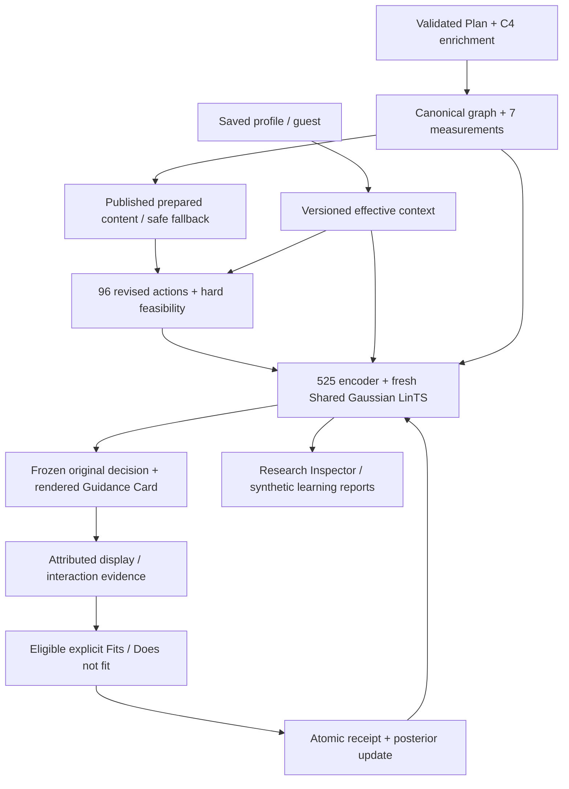

# C4 PP1 Shared Gaussian LinTS - implementation and reproduction

This phase starts from checkpoint fca66fe on c4/scaffolding-dimensions. All repository changes remain inside C4. No commit, push, branch switch, legacy deletion, posterior migration or live provider generation was performed. PP2 history scoring is NOT implemented.

## What runs now

The existing app.workspace:app owns one citizen workflow. The existing citizen Guidance Card consumes the same /workspace/guidance API. An explicit PP1 flag enables a NEW compatible 525-feature policy. The old host /v2/policy remains a compatibility/historical endpoint and is NOT the revised policy. Inspect /workspace/guidance/status instead.

Guest and personalization-OFF requests use complete standard guidance. Enabled saved profiles resolve service-specific familiarity, navigation confidence and confirmed revised preferences, then feasibility filters all 96 configurations and genuine LinTS scores the remaining candidates. One shared Gaussian parameter sample scores ALL candidates; the maximum sampled score wins. There are no rules assigning configurations to novices or experienced people, and differences between two requests are not guaranteed.

The selected configuration, original feature vector, context, source/content, candidate scores, sampling seed, policy run/revision and document are frozen. Display acknowledgment alone is not a reward. An eligible original personalized, displayed, never-adjusted view can supply Fits=1 or Does not fit=0. A zero updates precision and centered response just as the Gaussian model specifies; it does not artificially inflate uncertainty. Duplicates return the original receipt. Any manual adjustment permanently makes that journey ineligible for original-policy learning; manual child/preview ratings are diagnostics only. Guest/OFF/standard/comparison paths never train. New model-run mismatches return a conflict rather than reusing old decision vectors.

### Architecture



The standard path skips M. Content generation/review remains separate from model training. Missing reviewed content excludes unsupported rich variants and preserves source-safe guidance; the model cannot invent capabilities or facts.

## Exact approved encoder

See PP1-FEATURE-SCHEMA.json for all 525 ordered names, 52 context names, action names, normalization constants and fingerprint. Model: c4-shared-gaussian-pp1-1.0. Features: c4-features-pp1-1.0-525. Actions: c4-scaffolds-v3.0. Content: c4-guidance-content-3.0.

- 416 = 52 context terms x 8 action terms, context-major row order.
- 35 = seven user/procedure pairs x five reference-coded rating indicators.
- 65 = 13 user/procedure/scaffold interactions x five rating indicators, interaction-major order.
- 9 = selected scaffold pairs.
- Ablations are exact prefixes 416, 451, 516 and 525; no rescaling or hyperparameter tuning by held-out outcome.

Action order: guided, detailed, disclosure_on, inline, map, recap, segmentation, intercept. Binary reference states: overview, concise, disclosure off, relationship none, recap off, segmentation off. Inline and Map are mutually exclusive. Familiarity/confidence indicators: 1,2,3,4,unknown; known rating 5 is all zero in its user block. The 13 preference indicators cover BOTH states for each binary dimension and ALL THREE relationship states. Their reference is UNSET (all zero for that dimension), not an omitted preference state. IDs and individual interaction history are not scoring inputs. Accessibility/locks filter candidates, not user-benefit rules.

Lower pairs and triple targets (each rating-coded):

| User | Complete-only measurement | Triple targets |
|---|---|---|
| Familiarity | dependency_depth | Guided |
| Confidence | step_count | Guided, Segmentation |
| Familiarity | information_volume | Detailed, Segmentation |
| Confidence | dependency_count | Inline, Map |
| Familiarity | branch_count | Inline, Map |
| Familiarity | step_count | Recap, Segmentation |
| Confidence | parallel_group_count | Inline, Map |

These test context-dependent support-fit effects; their sign is learned, not prescribed. Nine pairs: Guided-Inline, Guided-Map, Guided-Recap, Detailed-Disclosure, Detailed-Segmentation, Inline-Segmentation, Map-Segmentation, Inline-Recap, Map-Recap. The 35 action-independent lower-order terms cancel in within-context rankings directly, but participate in the joint posterior/residual model; the 451 ablation measures their empirical contribution.

The seven measurements retain x/(x+scale), observed values, complete-only values and partial/unknown flags. Scales are 10 steps, 200 information units, 3 branches, 5 conditions, 10 dependencies, depth 5, 3 parallel groups. Unknown relationships are not zero-demand evidence: complete-only products are zero while unknown flags and observed values remain.

Norm proof: context squared norm <=23; action-with-intercept squared norm <=7, so outer block <=161. Lower pair block <=7, triple block <=10 (mutually exclusive Inline/Map), scaffold-pair block <=6. Divide blocks by sqrt(161),sqrt(7),sqrt(10),sqrt(6), then divide the concatenation by 2. Thus total squared norm <=1. Tests cover every legal configuration, all 36 familiarity/confidence combinations including unknown, saturated complete measurements and six active preferences; unknown coverage and scale mismatch are also tested.

## Gaussian model and storage

Only the existing tested _GaussianPosterior numerical kernel is reused. No old encoder/adapter/state is used. Prior mean zero, precision I, observation noise 1, exploration multiplier 1, centered binary target reward-0.5. For vector x: A <- A + xxT, b <- b + x(reward-0.5); Cholesky solves produce the posterior mean. One sampled theta has covariance A^-1; scores are 0.5 + phi theta. They are unbounded surrogate scores, NOT calibrated probabilities. No matrix inverse is used in selection or update.

PolicyStore requires an explicit C4/pp1-learning directory. It refuses unrelated schemas or mismatched seed/mode/model/checkpoint digest. Checkpoints have strict feature/action/content/model manifests, array shape/finiteness/symmetry/positive-definiteness checks and allow_pickle=False. The checkpoint files are read-only initializers; interactive feedback writes a separate policy.sqlite3. Initial checkpoint revision and later accepted feedback count are separate.

The journey SQLite transaction ATTACHes the isolated policy database using default rollback journals, so frozen decisions/counters and feedback receipt/posterior update commit or roll back together. Tests inject failure after the numerical update and verify neither record nor policy changes. Do not enable WAL or change the ownership model without revisiting attached-database crash atomicity. No V1 or V2 database is opened for migration.

## Synthetic method and actual results

S1-S6 are the supplied professional-review-pending families. S7 adds familiar/complex counterexamples, S8 unfamiliar/simple counterexamples, S9 null effects and S10 increased burden sensitivity. All are author-defined hypothetical scenarios; no external review response has been received. Broad literature concepts motivate the questions, but this implementation does NOT claim its numerical coefficients are derived from or validated by literature. There are no expert-correct configuration labels.

The simulator is separately versioned in synthetic.py. It maps context, actual measured structure and configuration to a continuous hypothetical fit probability: a logistic squared support/demand mismatch with declared preference and redundancy/burden terms, clipped to [0.08,0.92], then Bernoulli feedback. Exact formulas/constants and an implementation fingerprint are retained. Preferences can conflict with familiarity; hard restrictions always win. Unknown structural coverage is not treated as an exact demand. No source graph, phase or relationship is manufactured to help training.

Selection completes before probability/reward generation. Training observes ONLY the selected arm's reward. Evaluation alone enumerates counterfactual expected rewards for regret. Regret is max feasible simulator expected reward minus selected expected reward; it is not real-world regret or a logged-policy propensity estimate.

Experiment: 5 seeds (11,23,37,51,71), 600 observations per encoder/seed, 4 encoders = 12,000 updates. Checkpoints 0/50/200/600. All variants share each seed's scenario schedule and response-uniform stream. Every frozen checkpoint uses the same 70 held-out cases and per-case scoring seeds; evaluation never updates state. The conditional fictional procedure is held out completely from training; evaluation familiarity/confidence 2/4 are excluded from training 1/3/5/unknown. Three official-source procedures are fallback/readiness probes, not rich human-reviewed training examples. Only four fictional graphs exist; this is a limited structural demonstration, not broad government-procedure validation.

Mean final SYNTHETIC expected reward (95% Student-t intervals across five training seeds):

| Policy | Mean | CI half-width |
|---|---:|---:|
| 416 features | 0.5497 | 0.0123 |
| 451 features | 0.5499 | 0.0202 |
| 516 features | 0.5471 | 0.0192 |
| 525 features | 0.5374 | 0.0238 |
| Standard / minimal feasible | 0.7062 | 0 across seeds on this fixed expected-reward suite |
| Maximal feasible | 0.3556 | 0 across seeds |
| Uniform random feasible (analytic expectation) | 0.5077 | 0 across seeds |
| Simulator oracle | 0.7135 | 0 across seeds |

525 improves from its own initial sampled-policy average (~0.474) but does NOT beat standard/minimal and does NOT establish superiority over smaller encoders. Final regret is 0.1761 for 525. Constraint violations are zero across every recorded evaluation. Baseline zero intervals reflect fixed cases and exact simulator expectations; they are NOT certainty about real citizens or the reward assumptions. Reward curves are genuine and contain non-monotonic per-seed changes.

Sensitivity evaluation rescores the same selections under preference-shift, burden-shift and null assumptions without tuning/retraining. Full per-seed values are in report.json. The null model gives 0.6 expected reward irrespective of support. This is evaluation under alternative hypothetical assumptions, not evidence of robustness to actual citizens; alternative-regime retraining is not claimed. Earlier negative V2 results remain unchanged.

The approved 525 candidate remains the explicit demo model even though the smaller models have higher point estimates. No final architecture is selected solely by parameter count or tuned against the held-out results. Seed 11 was the first declared seed, not chosen for a favorable demo result.

## Files and evidence

- guidance/features.py: ordered encoder; policy.py: model/checkpoints/isolated transactional store.
- guidance/frontend_runtime.py and frontend_api.py: genuine selection, frozen Inspector evidence, original/manual feedback and research endpoints.
- guidance/synthetic.py: hidden hypothetical response model; experiment.py: schedules/training/frozen evaluation; replay.py: exact reconstruction; plots.py: Matplotlib SVG/PNG + HTML report.
- tests/test_pp1_learning.py: norm/schema, numerical updates, snapshots, attributed API ratings, zero rewards/concurrent duplicates, OFF/manual/guest exclusions, atomic rollback, reproducible experiments/replay, report gates.
- research/verify_pp1_learning_server.py: actual uvicorn/network selection/display/rating/duplicate/restart scenario; only its own child process is stopped.
- PP1-FEATURE-SCHEMA.json, PP1-SYNTHETIC-RESULTS.json, PP1-LIVE-VERIFICATION-FINAL.json, PP1-BROWSER-VERIFICATION.json: recorded evidence. Earlier initial smoke report is retained separately.
- Existing citizen UI remains; research-only panel adds actual decision JSON and a learning-report link. Ineligible feedback wording now includes adjusted views.

Actual artifacts are preserved under service/.local/pp1-learning/experiment-20261022-a (ignored runtime/research storage). Includes source/content snapshots, feature manifest, held-out cases, schedules, 20 traces, 80 checkpoints, report JSON/HTML and six SVG/PNG plots. Do not bulk-stage local databases/checkpoints/traces or credentials into Git. Source and compact documentation remain reviewable.

The 600-observation seed-11-525 trace replay matched every sampled candidate score, selected feature digest, update-chain link and final posterior exactly in the recorded numerical environment. Small experiments repeated twice also matched every trace and all four encoder states. Numerical library/platform differences can affect exact floating-point replay; Python/NumPy/SciPy/Unicode and schema metadata are recorded.

Real browser verification used a fresh sandbox: guest birth-copy guidance; profile familiarity 1/confidence 1 for practice; genuine selected configuration guided/concise/on/inline/on/on; explicit Fits; Inspector showed stored features/scores and one update. This configuration was NOT forced. Both browser verification servers were stopped afterward, freeing their ports. Screenshots are PP1-PERSONALIZED-BROWSER.png and PP1-INSPECTOR-BROWSER.png.

## Reproduce training and reports (PowerShell, service terminal)

```powershell
cd C:\Users\Lenovo\Desktop\HelaGuide\components\c4-presentation\service
$env:OPENBLAS_NUM_THREADS = '1'
$env:OMP_NUM_THREADS = '1'
$env:MKL_NUM_THREADS = '1'
$env:MPLCONFIGDIR = Join-Path (Get-Location) '.local\pp1-learning\mpl-cache'
# Optional first installation of declared research dependencies:
.\.venv\Scripts\python.exe -m pip install -e '.[dev,research]'
$c4Experiment = Join-Path (Get-Location) ('.local\pp1-learning\experiment-' + (Get-Date -Format 'yyyyMMdd-HHmmss'))
.\.venv\Scripts\python.exe -B -m app.studies.experiment --output $c4Experiment --train 600 --evaluation 70 --seeds 11 23 37 51 71
.\.venv\Scripts\python.exe -B -m app.studies.plots --directory $c4Experiment
.\.venv\Scripts\python.exe -B -m app.studies.replay --directory $c4Experiment --run seed-11-525
```

The training command refuses an existing output directory. Initialized and trained checkpoint comparisons are genuine n0 versus n600 evaluations on the same declared cases/seeds, available in report.json/report.html; they are not configuration previews. Keep final held-out cases out of tuning. Reuse this recorded protocol for replication, not for selecting favorable seeds.

## Run the trained PP1 app (backend terminal)

Stop only your previous C4 terminal process with Ctrl+C if it owns the desired port. Never kill an unidentified PID. These paths isolate the demo from all historical stores and preserve the trained checkpoint.

```powershell
cd C:\Users\Lenovo\Desktop\HelaGuide\components\c4-presentation\service
$env:OPENBLAS_NUM_THREADS = '1'
$env:OMP_NUM_THREADS = '1'
$env:C4_WORKSPACE_MODE = 'simulation'
$env:C4_WORKSPACE_DATABASE = Join-Path (Get-Location) '.local\v2\workspace\pp1-demo\state.sqlite3'
$env:C4_WORKSPACE_CONTENT_MODE = 'demo'
$env:C4_PREPARED_CONTENT_ENABLED = 'true'
$env:C4_PREPARED_CONTENT_MODE = 'demo'
$env:C4_PREPARED_CONTENT_DIRECTORY = Join-Path (Get-Location) '.local\prepared-content\pp1-demo'
$env:C4_PREPARATION_ON_MISS = 'false'
$env:C4_LLM_ENABLED = 'false'
$env:C4_DEV_LLM_ENABLED = 'false'
$env:C4_GUIDANCE_API_ENABLED = 'true'
$env:C4_RESEARCH_PREVIEWS_ENABLED = 'true'
$env:C4_PP1_POLICY_ENABLED = 'true'
$env:C4_PP1_POLICY_MODE = 'simulation'
$env:C4_PP1_POLICY_SEED = '11'
$env:C4_PP1_POLICY_DIRECTORY = Join-Path (Get-Location) '.local\pp1-learning\demo-interactive'
$env:C4_PP1_CHECKPOINT = Join-Path (Get-Location) '.local\pp1-learning\experiment-20261022-a\seed-11-525-n600.npz'
$env:C4_PP1_EXPERIMENT_DIRECTORY = Join-Path (Get-Location) '.local\pp1-learning\experiment-20261022-a'
.\.venv\Scripts\python.exe -B -m uvicorn app.workspace:app --host 127.0.0.1 --port 8018
```

These are stable demo paths: restarting with identical settings resumes existing state. Do not point them at old stores. A mismatched existing PP1 manifest is rejected; choose a new directory instead of resetting it. To compare an untrained app, use a DIFFERENT PP1 policy directory and set C4_PP1_CHECKPOINT to the n0 file, leaving the trained store intact. Previously issued journeys belong to their original run and cannot train a different run.

Frontend terminal:

```powershell
cd C:\Users\Lenovo\Desktop\HelaGuide\components\c4-presentation\demo-frontend
$env:VITE_C4_API_BASE_URL = 'http://127.0.0.1:8018'
node .\node_modules\vite\bin\vite.js --host=127.0.0.1 --port=5173 --strictPort
```

Open http://127.0.0.1:5173/ . The current citizen API uses VITE_C4_API_BASE_URL, not the historical VITE_C4_V2_API variable. Backend CORS permits this 5173 origin.

Safe reads (second terminal):

```powershell
Invoke-RestMethod 'http://127.0.0.1:8018/workspace/guidance/status' | ConvertTo-Json -Depth 8
Invoke-RestMethod 'http://127.0.0.1:8018/workspace/guidance/research/learning' | ConvertTo-Json -Depth 4
Invoke-RestMethod 'http://127.0.0.1:8018/workspace/guidance/research/traces/seed-11-525?offset=0&limit=3' | ConvertTo-Json -Depth 10
```

Research view -> learning report opens /workspace/guidance/research/learning/report.html; the JSON endpoint exposes the full report. Paginated trace endpoint returns real observation records, max 100 per page. These are local research interfaces, not production authentication. The ordinary citizen screen does not contain training dashboards.

## Reproducible PP1 demonstration

1. Guest: select Birth certificate copy -> Show guidance. Observe standard complete guidance, no model feedback.
2. Create novice alias profile: confidence 1, Practice familiarity 1, personalization ON. Select Practice -> Show guidance. This calls actual LinTS. Open Research view -> Inspector; check frozen configuration, seed, revision and candidate scores.
3. Create experienced alias: confidence 5, Practice familiarity 5. Request same procedure. Explain actual scores; do not promise a different winner. Both share the policy.
4. Select NIC or birth-copy for the same saved profile with a different saved familiarity. Explain different structure and smaller feasible set, without claiming unavailable Map/Detailed content exists.
5. Rate an untouched displayed original view. Read status before/after: revision and accepted-feedback count +1. Read/refresh/duplicate ratings never double-count. Adjust a support first on a new journey, then rate: diagnostic, no update.
6. Open the SYNTHETIC learning report: n0/50/200/600 curves, baseline losses, encoders, seed intervals, dimension distributions and zero constraint violations. State that external expert assessment and real-user benefit validation remain pending.

PP2 personal-history scoring/uncertainty/abstention is intentionally absent. Interaction evidence is retained only. No live LLM is called in these demo settings. Official source-fidelity review and richer government content remain separate editorial work, not solved by bandit training.

## Final verification results

- Final full backend suite: 507 passed, 24 skipped, zero failures, 72.17 s. All 24 skips require C4_TEST_POSTGRES_DSN, which was not configured. One existing Starlette/httpx deprecation warning remains.
- Final focused revised API/ML run: 45 passed, zero failures (32.85 s).
- Citizen/frontend: all 254 tests in 22 files passed; production TypeScript/Vite build and ESLint passed.
- Real uvicorn loopback: actual trained selection, display ack, Fits, exact duplicate receipt, posterior +1, restart equality, saved journey recovery and unchanged historical host policy passed.
- Actual browser: guest guidance, profile onboarding/service familiarity, personalized Guidance Card, explicit Fits and Inspector evidence verified. Only sandbox stores were written; test children were stopped.
- Exact replay: 600-observation seed-11-525 trace; all genuine scores and final state match. Repeat small experiments match all four encoder variants.
- Recorded benchmark (single BLAS thread, 525 terms/96 candidates): median numerical scoring 1.456 ms, update 8.126 ms over 30 observations. This excludes storage/API latency and is not an efficacy result.
- PostgreSQL regressions remain unexecuted; this PP1 store uses isolated SQLite. External provider connectivity, external expert validation, official rich-wording human review, real-citizen evaluation and PP2 are not claimed.
- Initial development failures (a duplicate frontend import and a test request-ID format) were corrected before final passing checks; no known unresolved test failure.

## Exact 52 context terms

1. `observed.step_count`
2. `observed.information_volume`
3. `observed.branch_count`
4. `observed.condition_count`
5. `observed.dependency_count`
6. `observed.dependency_depth`
7. `observed.parallel_group_count`
8. `complete_value.step_count`
9. `complete_value.information_volume`
10. `complete_value.branch_count`
11. `complete_value.condition_count`
12. `complete_value.dependency_count`
13. `complete_value.dependency_depth`
14. `complete_value.parallel_group_count`
15. `partial.step_count`
16. `unknown.step_count`
17. `partial.information_volume`
18. `unknown.information_volume`
19. `partial.branch_count`
20. `unknown.branch_count`
21. `partial.condition_count`
22. `unknown.condition_count`
23. `partial.dependency_count`
24. `unknown.dependency_count`
25. `partial.dependency_depth`
26. `unknown.dependency_depth`
27. `partial.parallel_group_count`
28. `unknown.parallel_group_count`
29. `familiarity.1`
30. `familiarity.2`
31. `familiarity.3`
32. `familiarity.4`
33. `familiarity.None`
34. `confidence.1`
35. `confidence.2`
36. `confidence.3`
37. `confidence.4`
38. `confidence.None`
39. `preference.navigation.overview`
40. `preference.navigation.guided`
41. `preference.explanation.concise`
42. `preference.explanation.detailed`
43. `preference.disclosure.off`
44. `preference.disclosure.on`
45. `preference.relationships.none`
46. `preference.relationships.inline`
47. `preference.relationships.map`
48. `preference.recap.off`
49. `preference.recap.on`
50. `preference.segmentation.off`
51. `preference.segmentation.on`
52. `intercept`
